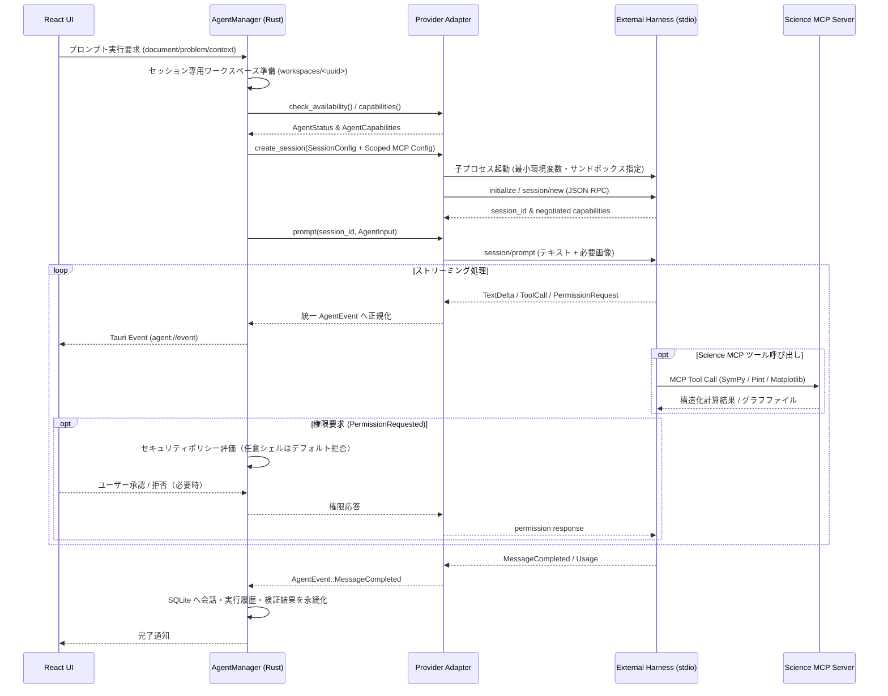

# AI ハーネス統合設計（Agent Integration）

> **ステータス**: Draft v1.0（Phase 0 PoC で各プロトコル詳細を実機検証予定）
> **最終更新**: 2026-11-25

---

## 1. 基本方針

- **既存公式ハーネスの活用**: 独自 AI 実行ハーネスは開発せず、ユーザーが公式手順でインストール・認証したハーネスを外部プロセスとして起動・管理する。
- **共通アダプター構成**: T3 Code を参考に、複数の公式ハーネスを Rust の共通インターフェース（`AgentAdapter`）で統一的に扱う。
- **ハイブリッドプロトコル戦略**: すべてのハーネスを無理に ACP へ統一しない。公式 ACP が利用できる場合（Antigravity / Custom ACP）は ACP を用い、専用プロトコルや SDK が公式である場合（Codex App Server / Claude Code）は専用アダプターを実装する。
- **未同梱原則**: 初期実装ではハーネス本体の同梱や自動インストールを必須とせず、自動検出・バージョン確認・手動パス指定を提供する。

---

## 2. 通信・プロセス管理アーキテクチャ



---

## 3. Rust 共通インターフェース設計

`src-tauri/src/agents/adapter.rs` に以下の共通 trait を定義する（Phase 0 の検証結果に基づき必要に応じて拡張する）。

```rust
#[async_trait]
pub trait AgentAdapter: Send + Sync {
    /// ハーネス実行ファイルの存在・バージョン・（取得可能なら）認証状態を確認する
    async fn check_availability(&self) -> Result<AgentStatus, AgentError>;

    /// プロバイダーおよびバージョンごとの対応機能（Capability）を返す
    async fn capabilities(&self) -> Result<AgentCapabilities, AgentError>;

    /// 隔離ワークスペース・MCP設定・モデル設定を用いてセッションを作成または再開する
    async fn create_session(
        &self,
        config: SessionConfig,
    ) -> Result<AgentSession, AgentError>;

    /// プロンプト（テキスト・画像・コンテキスト参照）を送信し、イベントストリームを返す
    async fn prompt(
        &self,
        session_id: &str,
        input: AgentInput,
    ) -> Result<AgentEventStream, AgentError>;

    /// 権限要求イベントへの応答を返す（対応アダプターのみ）
    async fn respond_permission(
        &self,
        session_id: &str,
        request_id: &str,
        decision: PermissionDecision,
    ) -> Result<(), AgentError>;

    /// 進行中のプロンプト処理を中断する
    async fn cancel(&self, session_id: &str) -> Result<(), AgentError>;

    /// セッションを終了し、必要に応じて子プロセスを安全に停止する
    async fn close_session(&self, session_id: &str) -> Result<(), AgentError>;
}
```

### 3.1 Capability Negotiation（`AgentCapabilities`）

ハーネスやバージョンごとに機能が異なるため、すべての機能について実行前に `AgentCapabilities` を参照する。**取得できない情報（認証状態・モデル一覧・利用量など）は推測せず `Unknown` / `None` として扱う。**

| フィールド | 型 | 説明 | 非対応時のフォールバック |
|---|---|---|---|
| `supports_image_input` | `bool` | 画像入力対応 | 問題画像認識を実行せず、対応エージェント選択を UI 通知 |
| `supports_pdf_input` | `bool` | PDF 直接入力対応 | PDF.js でページ画像＋抽出テキストへ変換して送信 |
| `supports_streaming` | `bool` | トークン逐次配信対応 | 完了時一括反映（待機インジケータ表示） |
| `supports_session_resume` | `bool` | 公式セッション再開対応 | SQLite 正本から必要会話履歴を新規セッションへ注入 |
| `supports_model_listing` | `bool` | モデル一覧取得対応 | モデル一覧を「未取得」表示し、ハーネス既定モデルを使用 |
| `supports_auth_status_check` | `bool` | 公式認証状態取得対応 | 認証状態を「未確認」と表示し公式認証ガイドを提示 |
| `supports_mcp_scoped_config` | `bool` | セッション単位 MCP 登録対応 | グローバル設定は変更せず Science MCP 連携を無効化・通知 |
| `supports_permission_hooks` | `bool` | クライアント主導の権限要求対応 | 公式サンドボックスで安全制限できない場合は機能制限 |
| `supports_sandbox_restriction` | `bool` | 任意シェル禁止・領域制限対応 | 必須権限制御を満たせないエージェントは該当機能を無効化 |
| `supports_cancel` | `bool` | プロトコルレベルのキャンセル対応 | 子プロセス単位での安全な中断・再起動へフォールバック |

---

## 4. 統一イベントモデル（`AgentEvent`）

各ハーネス固有の通知形式を内部イベントへ正規化する。すべてのイベントは共通エンベロープ（`event_id`, `run_id`, `session_id`, `message_id`, `timestamp`）を持つ。

```rust
pub struct AgentEventEnvelope {
    pub run_id: String,
    pub session_id: String,
    pub message_id: Option<String>,
    pub timestamp: String,
    pub event: AgentEvent,
}

pub enum AgentEvent {
    SessionStarted { external_session_id: Option<String>, resumed: bool },
    MessageStarted { role: String },
    TextDelta { text: String },
    ToolCallStarted { call_id: String, server: Option<String>, tool_name: String, arguments: serde_json::Value },
    ToolCallUpdated { call_id: String, status: String, progress: Option<String> },
    ToolCallCompleted { call_id: String, succeeded: bool, output: serde_json::Value },
    PermissionRequested { request_id: String, action: String, target: Option<String>, detail: String },
    ArtifactCreated { relative_path: String, mime_type: String, caption: Option<String> },
    UsageUpdated { input_tokens: Option<u64>, output_tokens: Option<u64>, raw_label: Option<String> },
    MessageCompleted { final_text: Option<String> },
    Cancelled { reason: Option<String> },
    Failed { code: String, message: String, rate_limited: bool, auth_required: bool },
}
```

> **重要制約**: プロバイダーが公式プロトコルで公開する進捗イベントのみを扱い、非公開の内部推論（hidden chain-of-thought）を取得・解析する実装は行わない。

---

## 5. プロバイダー別アダプター設計

| アダプター | モジュール | 接続プロトコル | CLI 検出コマンド例 | 備考 |
|---|---|---|---|---|
| **Codex** | `providers/codex/` | `codex app-server`（JSON-RPC 2.0 over `stdio`） | `codex --version` / `codex login status` | `OPENAI_API_KEY` を無断継承しない（ChatGPT サブスクリプション利用時の誤課金防止） |
| **Claude Code** | `providers/claude/` | 公式 CLI / Agent SDK / ACP アダプター（Phase 0 で確定） | `claude --version` | 利用規約上の認証方式制約あり（[provider-compatibility.md](./provider-compatibility.md) 参照） |
| **Antigravity** | `providers/antigravity/` | 公式 ACP（`agy acp`, JSON-RPC 2.0 over `stdio`） | `agy --version` | Rust `agent-client-protocol` クレートを共用可能 |
| **Custom ACP** | `providers/acp/` | 標準 ACP（JSON-RPC 2.0 over `stdio`） | ユーザー手動指定パス + 引数 | `initialize` 応答に基づき Capability を動的判定 |
| **Mock** | `providers/mock/` | インプロセス決定論モック | 外部依存なし | CI・統合テスト用（実接続テストと明確に区別） |

### 5.1 ACP 共通クライアント基盤

Zed の設計および公式 Rust クレート（`agent-client-protocol` / `agent_client_protocol_schema`）を Phase 0 で検証し、Antigravity ACP および Custom ACP で共通の JSON-RPC 2.0 over `stdio` トランスポート・`Client` trait 実装を再利用する。

---

## 6. エージェント管理機能

1. **自動検出と手動指定**:
   - Windows の `PATH`、既定のインストール先（`%LOCALAPPDATA%`, npm/cargo/uv global bin 等）を探索し、検出したバイナリに対して `--version` をタイムアウト付きで実行。
   - 自動検出できない場合や複数バージョン共存時は、設定画面から実行ファイルパスを手動指定可能。
2. **公式認証フローへの誘導**:
   - FormulaDesk 独自にログインフォームやトークン抽出を実装しない。
   - 認証が必要な場合は公式 CLI コマンド（例: `codex login`, `agy acp --login` 等）の案内および公式認証フロー起動ガイドを表示する。
3. **プロセス管理と異常終了復旧**:
   - Windows では Job Object 等を活用し、FormulaDesk 終了時に孤児子プロセスが残らないようにする。
   - 子プロセス異常終了時は `AgentEvent::Failed` を送出し、セッション状態を `crashed` に更新。次回操作時に新しいプロセスで安全に再初期化・会話履歴再投入を行う。
4. **利用上限エラーのハンドリング**:
   - レート制限・クォータ超過エラーを受信した場合は `rate_limited: true` としてユーザーへ明確に表示する。利用上限回避のための自動リトライ連打や別アカウント切替は実装しない。

---

## 7. セッション管理と用途別エージェント設定

### 7.1 会話履歴の正本とセッション再開

- **正本は SQLite**: ハーネス側のセッションストレージに依存せず、すべての会話・プロンプト・出力を FormulaDesk の `conversations` / `messages` に永続化する。
- **再開フロー**:
  1. 同一エージェントかつ `resumable == true` の場合: `external_session_id` を用いて公式セッション再開を試みる。
  2. 再開不可、セッション失効、または**異なる AI エージェントへ切り替えた場合**: 新規セッションを作成し、SQLite から必要最小限の会話履歴と現在の問題・解答コンテキストを要約/選択して渡す。
- **ストリーミング中断**: キャンセルやクラッシュ時は途中まで受信したテキストを `status = 'cancelled'` / `'failed'` として保存する。

### 7.2 用途別エージェント設定

ユーザーは以下の 5 用途ごとにプロファイルとモデルを選択できる（初期デフォルトはすべて単一の既定エージェント）。

1. **問題文の認識**（画像入力対応が必須）
2. **解答の生成**
3. **AI チャット**
4. **解答の検証**（Science MCP 連携推奨）
5. **解答の修正**（Phase 5）

> 複数エージェントを連鎖させる自動処理は初期バージョンでは必須とせず、各プロバイダーの利用条件を確認した上で Phase 5 以降に検討する。

---

## 8. Science MCP の安全な登録方針

- **グローバル設定の不変性**: `~/.codex/config.toml` や `~/.claude.json`、`~/.gemini/` 等のユーザー既存グローバル MCP 設定を無断で書き換えない。
- 各ハーネスがサポートする**起動時引数・セッション設定・プロジェクトローカル設定（隔離ワークスペース内）**経由で `science-mcp` のみを登録する。
- セッション単位の MCP 登録手段を持たないハーネスについては、その旨を Capability として扱いユーザーへ案内する。

---

## 関連ドキュメント

- [プロバイダー互換性と認証条件（provider-compatibility.md）](./provider-compatibility.md)
- [セキュリティ設計（security.md）](./security.md)
- [Science MCP Server 仕様（science-mcp.md）](./science-mcp.md)
- [ADR-0002: 外部 AI ハーネス統合方針](./adr/0002-external-ai-harness-and-adapter-layer.md)
