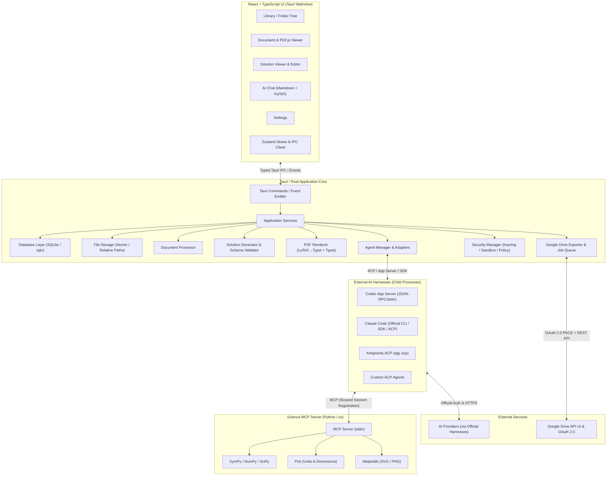

# FormulaDesk システムアーキテクチャ設計（Architecture）

> **ステータス**: Draft v1.0
> **最終更新**: 2026-11-25

---

## 1. アーキテクチャ全体像

FormulaDesk は **Tauri v2（Rust コア）+ React / TypeScript UI + 外部公式 AI ハーネス + Python Science MCP Server** のローカルファースト・マルチプロセス構成を採用する。



---

## 2. 設計原則

1. **UI とビジネスロジックの分離**: React 側は表示・入力制御・状態反映に専念し、ドメインロジック・永続化・外部プロセス制御は Rust 側（`application/` および各ドメインモジュール）に集約する。
2. **React から SQLite を直接操作しない**: すべての DB アクセスは Rust の `database/` 層を経由し、Tauri Command として型安全に公開する。
3. **ファイル操作は Rust 側で一元管理する**: ファイルのコピー、ハッシュ計算、アトミック保存、パス検証、削除は Rust の `storage/` 層で制御する。
4. **AI ハーネス固有の処理はアダプター層に隔離する**: `agents/providers/*` に各プロトコル（Codex App Server / Claude Code / Antigravity ACP / Custom ACP）の差異を閉じ込め、上位層は共通の `AgentAdapter` trait と `AgentEvent` のみを扱う。
5. **Google Drive 連携と AI 連携の独立性**: 両者は独立したサービスモジュールとし、AI エージェントに Google Drive の認証情報や操作権限を渡さない。
6. **AI エージェントの隔離**: AI エージェントに SQLite への直接アクセスやアプリ管理領域全体への参照を許可しない。実行ごとに専用ワークスペースを提供する。
7. **オフライン・障害耐性**: 外部 AI サービスや Google Drive が利用できない状態でも、ローカル保存済みの問題・解答・PDF・会話履歴を完全に閲覧できる。
8. **型整合性**: Rust（`serde`）と TypeScript（`src/types/`）間の IPC ペイロード型を一致させる（必要に応じて型生成や契約テストで検証する）。
9. **構造化エラーとユーザー向け変換**: Rust 側で型付きエラー（`error.rs`）を定義し、IPC 境界でエラーコード・原因・ユーザー向け日本語メッセージ・回復アクションへ変換する。
10. **最小権限と誠実な状態表示**: 取得できない情報（認証状態・利用量・モデル一覧）を推測補完せず「未取得」として扱う。

---

## 3. 参考 OSS の調査結果と設計への反映

実装に先立ち、以下の 3 つの参考 OSS を調査し、設計思想を取り入れる（コードの無条件コピーは行わず、各プロジェクトのライセンスを尊重する）。

| 参考 OSS | 調査ポイント | FormulaDesk への設計反映 |
|---|---|---|
| **T3 Code** (`pingdotgg/t3code`) | プロバイダー抽象化、アダプター設計、セッション管理、構造化イベント、ストリーミング、ACP と固有プロトコルの併用 | 独自 LLM プロキシを持たずローカル認証済み公式 CLI を子プロセス（`stdio`）起動する「Bring-Your-Own-Credentials」設計を採用。`codex app-server` や Claude SDK / ACP を共通アダプター層で吸収する。 |
| **Orca** (`stablyai/orca`) | インストール済み CLI 検出、プロセス管理、作業ディレクトリ隔離、複数エージェント状態管理 | 複数エージェントやセッションを独立したワークスペースへ隔離する思想を取り入れる。コーディング向け Git worktree の代わりに、数学・物理セッション専用の `workspaces/<session-uuid>/` を払い出し、プロセス状態（起動中/実行中/権限待ち/完了/異常終了）を明確に管理する。 |
| **Zed** (`zed-industries/zed`) | Rust による ACP クライアント実装、権限管理、ストリーミングイベント処理 | 公式 Rust クレート `agent-client-protocol` / `agent_client_protocol_schema` を活用した JSON-RPC 2.0 over `stdio` 通信、`initialize` での Capability Negotiation、`session/request_permission` によるクライアント主導の権限ゲート設計を採用する。 |

> **差別化方針**: 上記 3 つはいずれもコーディングエージェント向け環境である。FormulaDesk はコード編集 IDE ではなく、**問題 PDF・構造化解答・数式・計算検証・Typst PDF 生成を中心に据えた数学・物理学習専用ワークスペース**として設計する。

---

## 4. 採用技術スタック

| レイヤ / 項目 | 採用技術 | 選定理由・備考 |
|---|---|---|
| デスクトップ基盤 | Tauri v2 | 軽量・ネイティブ性能・Rust バックエンドとの統合・Capability ベースセキュリティ |
| フロントエンド | React / TypeScript / Vite / pnpm | 型安全性、豊富なエコシステム、高速ビルド |
| UI / スタイル / 状態 | Tailwind CSS / shadcn/ui / Lucide / Zustand | 一貫した軽量 UI、3 カラム・ダークモード対応、シンプルな状態管理 |
| PDF 表示・数式・Markdown | PDF.js / KaTeX / react-markdown | ブラウザ内での高速な PDF レンダリング・テキスト選択および数式描画 |
| バックエンド | Rust / Tokio / reqwest / serde | 安全性、非同期プロセス・ストリーム処理、クロスプラットフォーム単一バイナリ |
| データベース | SQLite / sqlx | ローカルファースト、埋め込み DB、型安全なクエリとマイグレーション |
| AI 通信・ツール連携 | ACP / Codex App Server / Agent SDK / MCP | 公式プロトコル優先・プロバイダー非依存・ツール実行の標準化 |
| 科学計算 | Python (`uv`) / MCP Python SDK / SymPy / NumPy / SciPy / Pint / Matplotlib | 大学数学・物理の記号計算・数値計算・次元解析・可視化の事実上標準 |
| PDF 生成 | Typst + LaTeX→Typst 変換層 | TeX Live 不要の高速・高品質組版（組み込み vs サイドカーは Phase 0 で確定） |
| クラウド連携・認証 | Google Drive API v3 / OAuth 2.0 + PKCE / OS キーチェーン (`keyring` 等) | 非センシティブスコープ `drive.file`・ローカルループバック・安全なトークン保管 |
| テスト・CI | Vitest / `cargo test` / `pytest` / GitHub Actions | 3 言語それぞれの標準テスト基盤による自動検証 |

---

## 5. レイヤ責務とモジュール構成

### 5.1 リポジトリ構成（段階的に構築）

```text
Theorem/ (FormulaDesk)
├── src/                        # React + TypeScript フロントエンド
│   ├── app/                    # アプリシェル・ルーティング・テーマ
│   ├── components/ui/          # shadcn/ui ベースの共通 UI 部品
│   ├── features/               # 機能単位モジュール
│   │   ├── library/            # 科目・フォルダ・検索・タグ
│   │   ├── document/           # 問題取り込み・PDF/画像ビューア
│   │   ├── problem/            # 問題認識結果の表示・編集
│   │   ├── solution/           # 解答表示・エディタ・バージョン管理
│   │   ├── chat/               # AI チャット・ストリーミング・差分承認
│   │   ├── agents/             # ハーネス検出・設定・認証ガイド
│   │   ├── verification/       # 計算結果・検証ステータス表示
│   │   ├── visualization/      # グラフ・図プレビュー
│   │   ├── google-drive/       # Drive 接続・アップロード状態・競合解決
│   │   └── settings/           # 11 カテゴリ設定画面
│   ├── hooks/                  # カスタムフック
│   ├── stores/                 # Zustand ストア（UI 状態・キャッシュ）
│   ├── services/               # Tauri IPC ラッパー（型安全な invoke / listen）
│   ├── types/                  # Rust と対応する DTO・イベント型定義
│   └── lib/                    # i18n・KaTeX/Markdown 設定・ユーティリティ
├── src-tauri/                  # Tauri / Rust コア
│   ├── src/
│   │   ├── commands/           # Tauri IPC コマンド（薄い入力受付・変換層）
│   │   ├── application/        # ユースケース調停（Application Services）
│   │   ├── domain/             # ドメインモデル・ルール（外部依存なし）
│   │   ├── agents/             # Agent Manager / Adapter trait / Events / Providers
│   │   │   └── providers/      # codex / claude / antigravity / acp / mock
│   │   ├── database/           # sqlx 接続プール・リポジトリ・マイグレーション実行
│   │   ├── storage/            # ローカルファイル管理・ハッシュ・アトミック保存
│   │   ├── document/           # インポート検証・PDF メタデータ・前処理補助
│   │   ├── solution/           # 構造化解答スキーマ検証・バージョン管理・差分
│   │   ├── chat/               # 会話・コンテキスト構築・セッション引き継ぎ
│   │   ├── pdf/                # LaTeX→Typst 変換・テンプレート適用・Typst 実行
│   │   ├── google_drive/       # OAuth PKCE・Drive API クライアント・永続ジョブキュー
│   │   ├── security/           # キーチェーン・パス検証・ワークスペース隔離・ログマスク
│   │   ├── error.rs            # 統一エラー型と IPC シリアライズ
│   │   └── lib.rs
│   ├── migrations/             # SQLite マイグレーション SQL
│   ├── capabilities/           # Tauri v2 最小権限 Capability 定義
│   ├── Cargo.toml
│   └── tauri.conf.json
├── science-mcp/                # Python ローカル MCP サーバー (uv 管理)
│   ├── pyproject.toml
│   ├── src/science_mcp/
│   │   ├── server.py
│   │   ├── parser.py           # 安全な数式パーサー（AST ホワイトリスト）
│   │   └── tools/              # algebra / calculus / linear_algebra / ode / dimensions / plotting
│   └── tests/
├── templates/                  # Typst PDF テンプレート (.typ)
├── schemas/                    # 解答データ・認識結果の JSON Schema
├── prompts/                    # 科目・用途別プロンプトテンプレート
├── fixtures/                   # テスト用数学・物理問題サンプルおよびモックデータ
├── scripts/                    # 開発・ビルド補助スクリプト
├── docs/                       # 設計・開発ドキュメント・ADR
└── .github/workflows/          # CI/CD ワークフロー
```

---

## 6. ローカルデータストレージ構成

アプリの保存領域は Tauri の `app_data_dir` 等を利用して OS ごとに決定する（例: Windows では `%APPDATA%\dev.theorem.desktop` 相当）。DB には絶対パスを保持せず、このルートからの相対パスを保存する。

```text
dev.theorem.desktop/
├── database/
│   └── theorem.db          # SQLite (WAL モード, FK 有効)
├── attachments/
│   ├── originals/              # 取り込み済み問題 PDF / 画像（原本不変）
│   ├── solutions/              # 生成済み解答 PDF
│   ├── diagrams/               # 生成・切り出し図
│   └── plots/                  # Science MCP 生成グラフ (SVG / PNG)
├── sources/                    # 構造化解答 JSON / 生成中間 .typ ソース
├── thumbnails/                 # ページ・画像サムネイル
├── templates/                  # ユーザーカスタマイズ可能な Typst テンプレート
├── workspaces/                 # エージェント実行セッション専用隔離領域
├── backups/                    # 手動/定期ローカルバックアップアーカイブ
├── logs/                       # 秘匿情報マスク済み診断ログ
└── settings.json               # 非機密アプリ設定
```

### 保存・整合性要件

- **UUID + SHA-256**: すべての添付ファイルに UUID と SHA-256 ハッシュを付与し、重複インポートを検出する。
- **アトミック書き込み**: 同一ボリューム内の一時ファイルへ書き込み・`sync_all` 後にリネームし、途中終了によるファイル破損を防ぐ。
- **バックアップと復元**: `theorem.db`（SQLite オンラインバックアップ API または `VACUUM INTO`）と `attachments/`・`sources/`・`settings.json` をまとめてバックアップ・復元可能にする。認証情報（OS キーチェーン内）はバックアップに含めない。
- **旧ライブラリの引き継ぎ**: 旧 `dev.formuladesk.app` の `database/formuladesk.db` と旧 ZIP の取り扱いは [ADR-0007](./adr/0007-phase2-persistence-and-request-identity.md) に従う。

---

## 7. IPC 通信とエラーハンドリング

### 7.1 Tauri IPC パターン

- **Command（Request/Response）**: CRUD、問題取り込み、PDF 生成、設定保存、Drive 操作など。すべての入力は `serde` で型検証し、戻り値は `Result<T, ApiError>` とする。
- **Event（Push Streaming）**:
  - `agent://event`（`AgentEvent`: テキストデルタ、ツール実行、権限要求、完了、エラー、キャンセル）
  - `drive://job-updated`（アップロード進捗・状態変化・競合通知）
  - `pdf://progress`（PDF 生成進捗・変換警告）

### 7.2 統一エラー設計

Rust 側でドメイン別のエラー型（`StorageError`, `DatabaseError`, `AgentError`, `PdfError`, `DriveError`, `SecurityError`, `ValidationError`）を `thiserror` 等で定義し、IPC 応答時には以下の構造へ変換する。

```rust
pub struct ApiError {
    pub code: String,          // 例: "AGENT_AUTH_REQUIRED", "PDF_LATEX_CONVERSION_FAILED"
    pub message: String,       // ユーザー向け日本語メッセージ
    pub detail: Option<String>,// 診断情報（秘匿情報は除外）
    pub recoverable: bool,     // リトライ・設定変更で回復可能か
}
```

---

## 関連ドキュメント

- [データベース設計（database.md）](./database.md)
- [AI ハーネス統合設計（agent-integration.md）](./agent-integration.md)
- [セキュリティ設計（security.md）](./security.md)
- [ADR 一覧（adr/README.md）](./adr/README.md)
