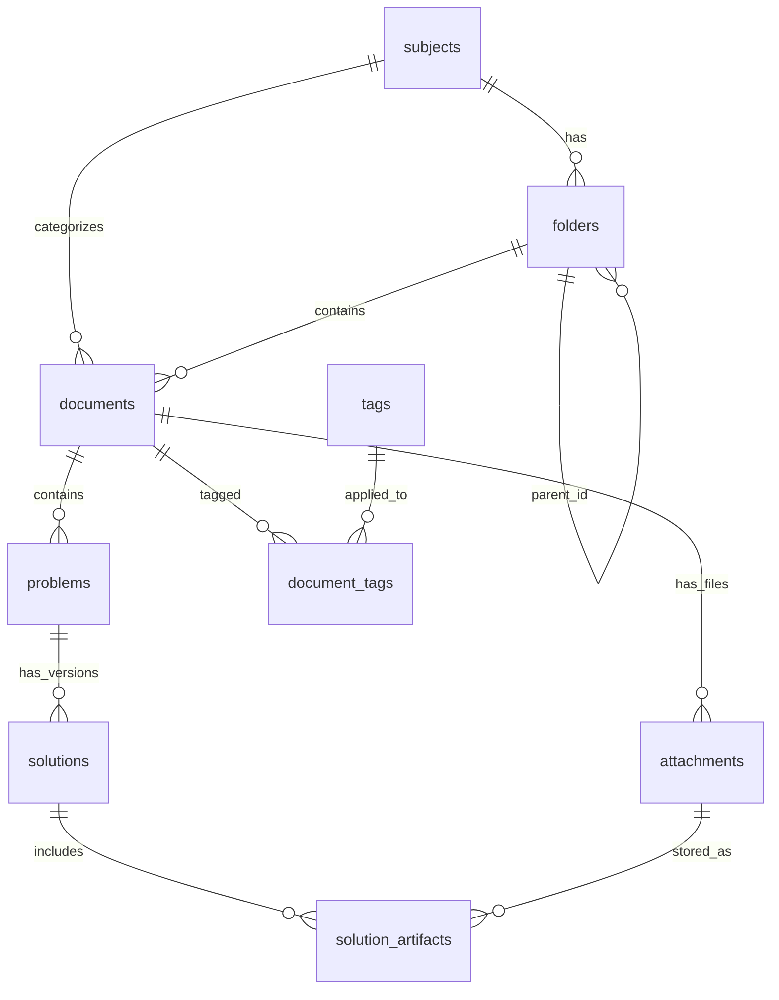
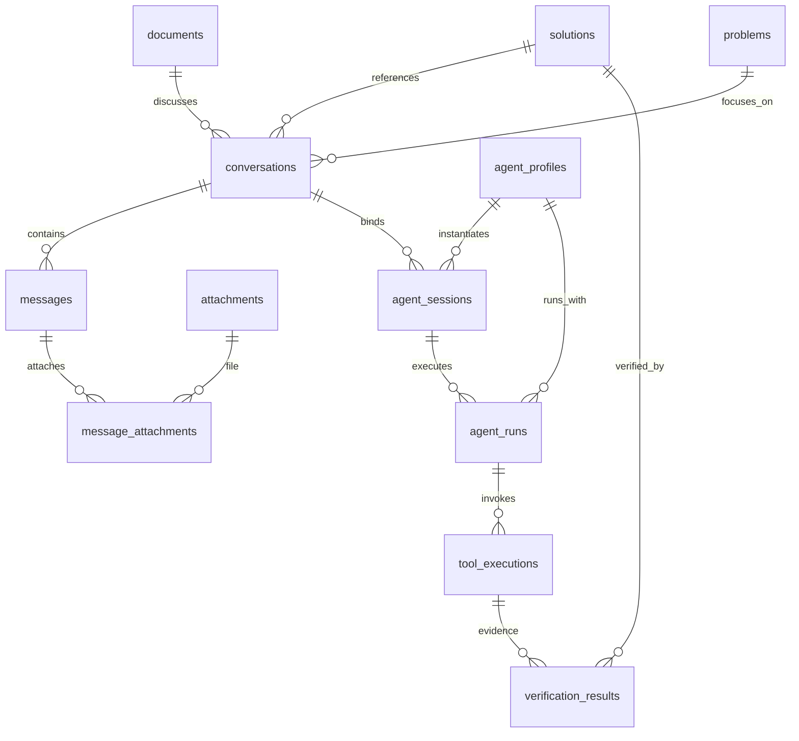
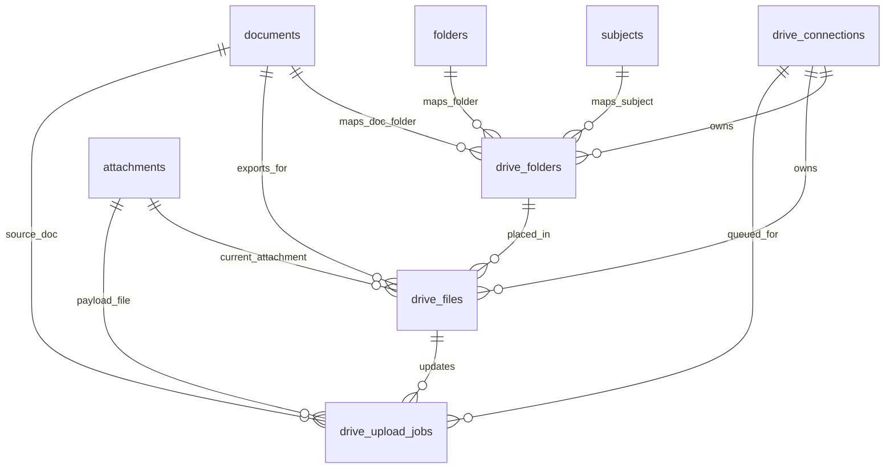

# FormulaDesk データベース設計（Database）

> **ステータス**: Draft v1.0
> **RDBMS**: SQLite 3（`sqlx` マイグレーション管理）
> **最終更新**: 2026-11-25

---

## 1. 基本方針

- **ローカル正本**: アプリ内の問題・解答・会話履歴・計算履歴・Drive マッピングの正本として `FormulaDesk/database/formuladesk.db` を使用する。
- **SQLite 設定**:
  - `PRAGMA foreign_keys = ON;`（接続ごとに必ず有効化）
  - `PRAGMA journal_mode = WAL;`（読み書き並行性とクラッシュ耐性の確保）
  - `PRAGMA busy_timeout = 5000;`
- **識別子**: 原則として UUID v4（または時系列ソート可能な UUID v7）の `TEXT` 型を主キーとする。
- **日時**: UTC ISO 8601 文字列（例: `2026-11-25T01:46:37Z`）を `TEXT` 型で統一保存する。
- **パス保存**: ファイルシステム上のパスはアプリ管理領域ルートからの相対パス（`/` 区切り正規化）で保存し、OS 絶対パスに依存しない。
- **機密情報の分離**: API キー・OAuth アクセストークン・リフレッシュトークン・パスワードは **SQLite に平文保存しない**（OS キーチェーン等の安全なストレージに保存し、DB には参照キーのみ記録する）。
- **同期禁止**: `formuladesk.db` 自体を Google Drive 等へ自動同期する機能は実装しない。

---

## 2. ER 図

### 2.1 ライブラリ・問題・解答ドメイン



### 2.2 チャット・AI エージェント・計算検証ドメイン



### 2.3 Google Drive 連携ドメイン



---

## 3. テーブル定義（全 21 テーブル）

### 3.1 ライブラリ・ドキュメント・問題・解答系

#### 1. `subjects`（科目）

| カラム | 型 | 制約 | 説明 |
|---|---|---|---|
| `id` | TEXT | PK | UUID |
| `name` | TEXT | NOT NULL, UNIQUE | 科目名（例: `大学数学`, `大学物理`） |
| `category` | TEXT | NOT NULL | `mathematics` / `physics` / `other` |
| `description` | TEXT | NULL | 説明 |
| `sort_order` | INTEGER | NOT NULL DEFAULT 0 | 表示順 |
| `created_at` | TEXT | NOT NULL | 作成日時 |
| `updated_at` | TEXT | NOT NULL | 更新日時 |

#### 2. `folders`（階層型フォルダ）

| カラム | 型 | 制約 | 説明 |
|---|---|---|---|
| `id` | TEXT | PK | UUID |
| `subject_id` | TEXT | NOT NULL, FK → `subjects(id)` ON DELETE CASCADE | 所属科目 |
| `parent_id` | TEXT | NULL, FK → `folders(id)` ON DELETE CASCADE | 親フォルダ（ルートは NULL） |
| `name` | TEXT | NOT NULL | フォルダ名 |
| `auto_upload_drive` | INTEGER | NOT NULL DEFAULT 0 | フォルダ単位 Drive 自動アップロード（0/1） |
| `sort_order` | INTEGER | NOT NULL DEFAULT 0 | 表示順 |
| `created_at` | TEXT | NOT NULL | 作成日時 |
| `updated_at` | TEXT | NOT NULL | 更新日時 |

- **UNIQUE**: `(subject_id, COALESCE(parent_id, ''), name)`（同一階層内の同名禁止; SQLite 式インデックスで実現）

#### 3. `documents`（問題ドキュメント）

| カラム | 型 | 制約 | 説明 |
|---|---|---|---|
| `id` | TEXT | PK | UUID |
| `subject_id` | TEXT | NOT NULL, FK → `subjects(id)` ON DELETE RESTRICT | 科目 |
| `folder_id` | TEXT | NULL, FK → `folders(id)` ON DELETE SET NULL | 所属フォルダ |
| `title` | TEXT | NOT NULL | ドキュメント名（例: `2026年度中間試験`） |
| `source_type` | TEXT | NOT NULL | `pdf` / `image` / `multi_image` |
| `primary_attachment_id` | TEXT | NULL, FK → `attachments(id)` ON DELETE SET NULL | 主たる原本ファイル |
| `page_count` | INTEGER | NULL | PDF ページ数（画像は 1） |
| `recognition_mode` | TEXT | NOT NULL DEFAULT 'printed_only' | `printed_only` / `include_handwriting` / `page_range` / `handwritten_answer` |
| `study_status` | TEXT | NOT NULL DEFAULT 'unstarted' | `unstarted` / `in_progress` / `solved` / `review_needed`（Phase 5 拡張活用） |
| `is_favorite` | INTEGER | NOT NULL DEFAULT 0 | お気に入り（0/1） |
| `last_opened_at` | TEXT | NULL | 最終閲覧日時 |
| `created_at` | TEXT | NOT NULL | 作成日時 |
| `updated_at` | TEXT | NOT NULL | 更新日時 |

#### 4. `attachments`（実ファイルの管理）

| カラム | 型 | 制約 | 説明 |
|---|---|---|---|
| `id` | TEXT | PK | UUID |
| `document_id` | TEXT | NULL, FK → `documents(id)` ON DELETE SET NULL | 関連ドキュメント |
| `kind` | TEXT | NOT NULL | `original_pdf` / `original_image` / `solution_pdf` / `diagram` / `plot` / `thumbnail` / `chat_image` / `source_json` / `source_typst` |
| `original_filename` | TEXT | NOT NULL | 元ファイル名 |
| `relative_path` | TEXT | NOT NULL, UNIQUE | アプリ管理領域からの相対パス |
| `mime_type` | TEXT | NOT NULL | MIME タイプ |
| `byte_size` | INTEGER | NOT NULL | ファイルサイズ（バイト） |
| `sha256` | TEXT | NOT NULL | SHA-256 ハッシュ（重複検出・整合性確認用） |
| `width` | INTEGER | NULL | 画像幅（px） |
| `height` | INTEGER | NULL | 画像高さ（px） |
| `page_count` | INTEGER | NULL | PDF ページ数 |
| `created_at` | TEXT | NOT NULL | 作成日時 |

- **重複検出**: 取り込み時に `kind IN ('original_pdf', 'original_image')` かつ `sha256 = ?` を検索し、既存ドキュメントが存在すればユーザーへ重複通知する（強制拒否ではなく参照または別登録を選択可能）。

#### 5. `problems`（個別の問題）

| カラム | 型 | 制約 | 説明 |
|---|---|---|---|
| `id` | TEXT | PK | UUID |
| `document_id` | TEXT | NOT NULL, FK → `documents(id)` ON DELETE CASCADE | 親ドキュメント |
| `problem_number` | TEXT | NOT NULL | 問題番号（例: `1`, `第2問`） |
| `subproblem_number` | TEXT | NULL | 小問番号（例: `(1)`, `(a)`） |
| `sort_order` | INTEGER | NOT NULL DEFAULT 0 | ドキュメント内順序 |
| `subject_category` | TEXT | NOT NULL | `mathematics` / `physics` / `other` |
| `field` | TEXT | NULL | 分野（例: `linear_algebra`, `classical_mechanics`） |
| `statement_markdown` | TEXT | NOT NULL | 認識・編集済み問題文（Markdown + LaTeX） |
| `given_conditions_json` | TEXT | NULL | 与えられた条件（JSON 配列） |
| `target_objective` | TEXT | NULL | 求める対象 |
| `source_pages_json` | TEXT | NULL | 掲載ページ番号・領域座標（JSON） |
| `figure_refs_json` | TEXT | NULL | 図・グラフ参照情報（JSON） |
| `uncertainties_json` | TEXT | NULL | 判別不能・要確認箇所のリスト（JSON） |
| `is_user_verified` | INTEGER | NOT NULL DEFAULT 0 | ユーザー確認・修正済みフラグ |
| `created_at` | TEXT | NOT NULL | 作成日時 |
| `updated_at` | TEXT | NOT NULL | 更新日時 |

#### 6. `solutions`（解答バージョン）

| カラム | 型 | 制約 | 説明 |
|---|---|---|---|
| `id` | TEXT | PK | UUID |
| `document_id` | TEXT | NOT NULL, FK → `documents(id)` ON DELETE CASCADE | 対象ドキュメント |
| `problem_id` | TEXT | NULL, FK → `problems(id)` ON DELETE CASCADE | 個別問題（ドキュメント全体のまとめ解答は NULL） |
| `version_number` | INTEGER | NOT NULL | 1 から連番のバージョン番号 |
| `parent_solution_id` | TEXT | NULL, FK → `solutions(id)` ON DELETE SET NULL | 派生元バージョン（部分修正時） |
| `is_current` | INTEGER | NOT NULL DEFAULT 1 | 当該スコープでの最新版フラグ（0/1） |
| `mode` | TEXT | NOT NULL | `standard` / `concise` / `detailed` / `rigorous` / `beginner` / `hint` / `verified` / `review` |
| `schema_version` | INTEGER | NOT NULL DEFAULT 1 | 構造化解答スキーマバージョン |
| `structured_json` | TEXT | NOT NULL | スキーマ検証済み解答 JSON |
| `validation_status` | TEXT | NOT NULL | `valid` / `invalid` / `user_edited` |
| `typst_source_attachment_id` | TEXT | NULL, FK → `attachments(id)` ON DELETE SET NULL | 生成された `.typ` ファイル |
| `pdf_attachment_id` | TEXT | NULL, FK → `attachments(id)` ON DELETE SET NULL | 生成された解答 PDF ファイル |
| `agent_run_id` | TEXT | NULL, FK → `agent_runs(id)` ON DELETE SET NULL | 生成元の AI 実行 ID |
| `model_name` | TEXT | NULL | 生成に使用したモデル名（取得可能な場合） |
| `change_summary` | TEXT | NULL | バージョン変更概要（部分修正時） |
| `created_at` | TEXT | NOT NULL | 作成日時 |
| `updated_at` | TEXT | NOT NULL | 更新日時 |

- **UNIQUE**: `(document_id, COALESCE(problem_id, ''), version_number)`（式インデックス）
- **部分ユニーク制約**: `WHERE is_current = 1` に対し `(document_id, COALESCE(problem_id, ''))` を一意にし、最新版が常に 1 件以下であることを保証する。

#### 7. `solution_artifacts`（解答内の図・グラフ）

| カラム | 型 | 制約 | 説明 |
|---|---|---|---|
| `id` | TEXT | PK | UUID |
| `solution_id` | TEXT | NOT NULL, FK → `solutions(id)` ON DELETE CASCADE | 所属解答バージョン |
| `attachment_id` | TEXT | NOT NULL, FK → `attachments(id)` ON DELETE RESTRICT | 実ファイル参照 |
| `artifact_type` | TEXT | NOT NULL | `plot` / `diagram` / `crop` / `table` |
| `caption` | TEXT | NULL | 図・グラフのキャプション |
| `source_tool_execution_id` | TEXT | NULL, FK → `tool_executions(id)` ON DELETE SET NULL | 生成元の計算ツール実行 |
| `sort_order` | INTEGER | NOT NULL DEFAULT 0 | 表示順 |
| `created_at` | TEXT | NOT NULL | 作成日時 |

#### 8. `tags`（タグ）

| カラム | 型 | 制約 | 説明 |
|---|---|---|---|
| `id` | TEXT | PK | UUID |
| `name` | TEXT | NOT NULL, UNIQUE | タグ名 |
| `color` | TEXT | NULL | 表示色コード |
| `created_at` | TEXT | NOT NULL | 作成日時 |

#### 9. `document_tags`（タグ関連付け）

| カラム | 型 | 制約 | 説明 |
|---|---|---|---|
| `document_id` | TEXT | PK (複合), FK → `documents(id)` ON DELETE CASCADE | ドキュメント ID |
| `tag_id` | TEXT | PK (複合), FK → `tags(id)` ON DELETE CASCADE | タグ ID |
| `created_at` | TEXT | NOT NULL | 付与日時 |

---

### 3.2 会話・AI エージェント・計算検証系

#### 10. `conversations`（チャットスレッド）

| カラム | 型 | 制約 | 説明 |
|---|---|---|---|
| `id` | TEXT | PK | UUID |
| `document_id` | TEXT | NOT NULL, FK → `documents(id)` ON DELETE CASCADE | 関連ドキュメント |
| `problem_id` | TEXT | NULL, FK → `problems(id)` ON DELETE SET NULL | 関連個別問題 |
| `solution_id` | TEXT | NULL, FK → `solutions(id)` ON DELETE SET NULL | 参照基準の解答バージョン |
| `title` | TEXT | NOT NULL | スレッドタイトル |
| `created_at` | TEXT | NOT NULL | 作成日時 |
| `updated_at` | TEXT | NOT NULL | 更新日時 |

#### 11. `messages`（会話履歴）

| カラム | 型 | 制約 | 説明 |
|---|---|---|---|
| `id` | TEXT | PK | UUID |
| `conversation_id` | TEXT | NOT NULL, FK → `conversations(id)` ON DELETE CASCADE | 親スレッド |
| `role` | TEXT | NOT NULL | `user` / `assistant` / `system` |
| `content_markdown` | TEXT | NOT NULL | メッセージ本文（Markdown + LaTeX） |
| `status` | TEXT | NOT NULL DEFAULT 'completed' | `streaming` / `completed` / `cancelled` / `failed` |
| `agent_run_id` | TEXT | NULL, FK → `agent_runs(id)` ON DELETE SET NULL | 応答生成元の実行 ID |
| `referenced_problem_id` | TEXT | NULL, FK → `problems(id)` ON DELETE SET NULL | 参照中の問題 ID |
| `revision_patch_json` | TEXT | NULL | 解答部分修正の提案差分（Phase 5） |
| `revision_status` | TEXT | NULL | `pending` / `approved` / `rejected`（Phase 5） |
| `created_at` | TEXT | NOT NULL | 作成日時 |
| `updated_at` | TEXT | NOT NULL | 更新日時 |

#### 12. `message_attachments`（メッセージ添付）

| カラム | 型 | 制約 | 説明 |
|---|---|---|---|
| `id` | TEXT | PK | UUID |
| `message_id` | TEXT | NOT NULL, FK → `messages(id)` ON DELETE CASCADE | 親メッセージ |
| `attachment_id` | TEXT | NOT NULL, FK → `attachments(id)` ON DELETE RESTRICT | 添付ファイル |
| `created_at` | TEXT | NOT NULL | 作成日時 |

#### 13. `agent_profiles`（AI エージェント設定）

| カラム | 型 | 制約 | 説明 |
|---|---|---|---|
| `id` | TEXT | PK | UUID |
| `name` | TEXT | NOT NULL, UNIQUE | 表示名（例: `Codex (Default)`） |
| `provider_kind` | TEXT | NOT NULL | `codex` / `claude_code` / `antigravity` / `custom_acp` / `mock` |
| `executable_path` | TEXT | NULL | 手動指定パス（自動検出時は NULL） |
| `args_json` | TEXT | NULL | 追加起動引数（JSON 配列） |
| `default_model` | TEXT | NULL | 選択モデル（対応プロバイダーのみ） |
| `auth_mode` | TEXT | NOT NULL DEFAULT 'official_harness' | `official_harness` / `api_key_keyring`（明示選択時のみ） |
| `credential_ref` | TEXT | NULL | OS キーチェーン参照キー（平文トークン禁止） |
| `capabilities_cache_json` | TEXT | NULL | 直近検出した Capability キャッシュ |
| `is_enabled` | INTEGER | NOT NULL DEFAULT 1 | 有効フラグ |
| `is_default` | INTEGER | NOT NULL DEFAULT 0 | デフォルトエージェントフラグ |
| `created_at` | TEXT | NOT NULL | 作成日時 |
| `updated_at` | TEXT | NOT NULL | 更新日時 |

※用途別エージェント割り当て（問題認識・解答生成・チャット・検証・修正）は `settings.json` または `agent_profiles` の参照 ID で管理する。

#### 14. `agent_sessions`（外部セッション）

| カラム | 型 | 制約 | 説明 |
|---|---|---|---|
| `id` | TEXT | PK | FormulaDesk 内部セッション UUID |
| `agent_profile_id` | TEXT | NOT NULL, FK → `agent_profiles(id)` ON DELETE CASCADE | 使用プロファイル |
| `conversation_id` | TEXT | NULL, FK → `conversations(id)` ON DELETE SET NULL | 紐づくチャット |
| `external_session_id` | TEXT | NULL | ハーネス側セッション ID |
| `workspace_rel_path` | TEXT | NOT NULL | セッション専用ワークスペース相対パス |
| `status` | TEXT | NOT NULL | `active` / `paused` / `closed` / `crashed` |
| `resumable` | INTEGER | NOT NULL DEFAULT 0 | 公式セッション再開可否 |
| `created_at` | TEXT | NOT NULL | 作成日時 |
| `updated_at` | TEXT | NOT NULL | 更新日時 |

#### 15. `agent_runs`（AI 実行履歴）

| カラム | 型 | 制約 | 説明 |
|---|---|---|---|
| `id` | TEXT | PK | 実行 UUID |
| `agent_session_id` | TEXT | NULL, FK → `agent_sessions(id)` ON DELETE SET NULL | 実行セッション |
| `agent_profile_id` | TEXT | NOT NULL, FK → `agent_profiles(id)` ON DELETE RESTRICT | 実行エージェント |
| `purpose` | TEXT | NOT NULL | `extraction` / `solution` / `chat` / `verification` / `revision` |
| `document_id` | TEXT | NULL, FK → `documents(id)` ON DELETE SET NULL | 対象ドキュメント |
| `problem_id` | TEXT | NULL, FK → `problems(id)` ON DELETE SET NULL | 対象問題 |
| `model_name` | TEXT | NULL | 実行モデル名 |
| `status` | TEXT | NOT NULL | `running` / `completed` / `cancelled` / `failed` |
| `usage_json` | TEXT | NULL | 公式に取得できたトークン/利用量情報（未取得は NULL） |
| `error_code` | TEXT | NULL | 失敗時エラーコード |
| `error_message` | TEXT | NULL | ユーザー向けエラー概要（秘匿情報除外） |
| `started_at` | TEXT | NOT NULL | 開始日時 |
| `finished_at` | TEXT | NULL | 終了日時 |

#### 16. `tool_executions`（計算ツール実行履歴）

| カラム | 型 | 制約 | 説明 |
|---|---|---|---|
| `id` | TEXT | PK | UUID |
| `agent_run_id` | TEXT | NOT NULL, FK → `agent_runs(id)` ON DELETE CASCADE | 呼び出し元 AI 実行 |
| `server_name` | TEXT | NOT NULL | `science-mcp` 等 |
| `tool_name` | TEXT | NOT NULL | `differentiate`, `check_dimensions` 等 |
| `arguments_json` | TEXT | NOT NULL | ツール引数 JSON |
| `result_json` | TEXT | NULL | ツール返却結果 JSON |
| `status` | TEXT | NOT NULL | `running` / `succeeded` / `failed` / `timeout` / `cancelled` |
| `duration_ms` | INTEGER | NULL | 実行時間（ミリ秒） |
| `error_message` | TEXT | NULL | エラー内容 |
| `created_at` | TEXT | NOT NULL | 実行開始日時 |
| `finished_at` | TEXT | NULL | 実行終了日時 |

#### 17. `verification_results`（検証結果）

| カラム | 型 | 制約 | 説明 |
|---|---|---|---|
| `id` | TEXT | PK | UUID |
| `solution_id` | TEXT | NOT NULL, FK → `solutions(id)` ON DELETE CASCADE | 対象解答バージョン |
| `tool_execution_id` | TEXT | NULL, FK → `tool_executions(id)` ON DELETE SET NULL | 実計算ツール実行の根拠（AI 自己申告時は NULL） |
| `source_kind` | TEXT | NOT NULL | `science_mcp` / `ai_self_check` / `user_check`（実ツール検証と AI 出力を明確分離） |
| `target_description` | TEXT | NOT NULL | 検証対象（例: `運動方程式の次元整合性`） |
| `assumptions_json` | TEXT | NULL | 検証時の仮定・定義域（JSON） |
| `method` | TEXT | NOT NULL | 使用手法（例: `sympy.verify_equation`, `pint.check_dimensions`） |
| `status` | TEXT | NOT NULL | `passed` / `failed` / `inconclusive` / `not_run` / `error` |
| `detail_json` | TEXT | NULL | 詳細結果・反例・数値差など |
| `created_at` | TEXT | NOT NULL | 記録日時 |

---

### 3.3 Google Drive 連携系

#### 18. `drive_connections`（Google Drive 接続情報）

| カラム | 型 | 制約 | 説明 |
|---|---|---|---|
| `id` | TEXT | PK | UUID |
| `account_email` | TEXT | NOT NULL, UNIQUE | 接続 Google アカウント識別子 |
| `credential_ref` | TEXT | NOT NULL | OS キーチェーン参照キー（トークン本体は保存しない） |
| `scopes_json` | TEXT | NOT NULL | 付与済みスコープ一覧（原則 `drive.file` のみ） |
| `root_folder_drive_id` | TEXT | NULL | `My Drive/FormulaDesk` 等のルート Drive フォルダ ID |
| `root_folder_name` | TEXT | NOT NULL DEFAULT 'FormulaDesk' | ルートフォルダ表示名 |
| `upload_mode` | TEXT | NOT NULL DEFAULT 'manual' | `manual` / `auto` / `folder_auto` |
| `version_policy` | TEXT | NOT NULL DEFAULT 'update_latest' | `update_latest` / `create_new` / `manual_version` |
| `status` | TEXT | NOT NULL | `connected` / `reauth_required` / `disconnected` |
| `created_at` | TEXT | NOT NULL | 作成日時 |
| `updated_at` | TEXT | NOT NULL | 更新日時 |

#### 19. `drive_folders`（Drive フォルダ対応）

| カラム | 型 | 制約 | 説明 |
|---|---|---|---|
| `id` | TEXT | PK | UUID |
| `connection_id` | TEXT | NOT NULL, FK → `drive_connections(id)` ON DELETE CASCADE | Drive 接続 |
| `entity_type` | TEXT | NOT NULL | `root` / `subject` / `folder` / `document` |
| `entity_id` | TEXT | NULL | 対応するローカル UUID（`root` のみ NULL） |
| `drive_folder_id` | TEXT | NOT NULL | Google Drive 上のフォルダ ID |
| `parent_drive_folder_id` | TEXT | NULL | 親 Drive フォルダ ID |
| `folder_name` | TEXT | NOT NULL | Drive フォルダ名 |
| `created_at` | TEXT | NOT NULL | 作成日時 |
| `updated_at` | TEXT | NOT NULL | 更新日時 |

- **UNIQUE**: `(connection_id, entity_type, COALESCE(entity_id, ''))`

#### 20. `drive_files`（Drive ファイル対応）

| カラム | 型 | 制約 | 説明 |
|---|---|---|---|
| `id` | TEXT | PK | UUID |
| `connection_id` | TEXT | NOT NULL, FK → `drive_connections(id)` ON DELETE CASCADE | Drive 接続 |
| `document_id` | TEXT | NOT NULL, FK → `documents(id)` ON DELETE SET NULL | ローカルドキュメント（ローカル削除後も履歴追跡可能に保持し Drive は自動削除しない） |
| `logical_role` | TEXT | NOT NULL | `original_problem` / `latest_solution_pdf` / `solution_version:<ver>` / `source` / `artifact:<id>` |
| `drive_file_id` | TEXT | NOT NULL | Google Drive ファイル ID（同一 ID 更新の要） |
| `drive_folder_id` | TEXT | NOT NULL | 配置先 Drive フォルダ ID |
| `drive_filename` | TEXT | NOT NULL | Drive 上のファイル名（例: `問題.pdf`, `解答.pdf`） |
| `last_uploaded_attachment_id` | TEXT | NULL, FK → `attachments(id)` ON DELETE SET NULL | 最後にアップロードしたローカル添付 ID |
| `last_uploaded_sha256` | TEXT | NULL | 最終アップロード時のローカル SHA-256 |
| `remote_md5_checksum` | TEXT | NULL | Drive API の `md5Checksum`（外部変更検出用） |
| `remote_modified_time` | TEXT | NULL | Drive API の `modifiedTime`（外部変更検出用） |
| `remote_version` | TEXT | NULL | Drive API の `version`（外部変更検出用） |
| `sync_status` | TEXT | NOT NULL | `uploaded` / `update_required` / `conflict` / `remote_deleted` / `error` |
| `created_at` | TEXT | NOT NULL | 作成日時 |
| `updated_at` | TEXT | NOT NULL | 更新日時 |

- **UNIQUE**: `(connection_id, document_id, logical_role)`（`document_id IS NOT NULL` のとき）
- **重要設計**: 解答のローカルバージョンが v1 → v2 に更新されても、`logical_role = 'latest_solution_pdf'` に紐づく同一の `drive_file_id` を参照して `files.update` を実行することで共有リンクを維持する。ローカルの `attachment_id` の変化だけで新規作成しない。

#### 21. `drive_upload_jobs`（アップロードジョブ）

| カラム | 型 | 制約 | 説明 |
|---|---|---|---|
| `id` | TEXT | PK | UUID |
| `connection_id` | TEXT | NOT NULL, FK → `drive_connections(id)` ON DELETE CASCADE | Drive 接続 |
| `document_id` | TEXT | NOT NULL, FK → `documents(id)` ON DELETE CASCADE | 対象ドキュメント |
| `logical_role` | TEXT | NOT NULL | 論理アップロード対象キー |
| `attachment_id` | TEXT | NOT NULL, FK → `attachments(id)` ON DELETE RESTRICT | アップロード実ファイル |
| `drive_file_id` | TEXT | NULL | 既存更新時の Drive ファイル ID（または事前確保 ID） |
| `idempotency_key` | TEXT | NOT NULL | `appProperties` にも記録する冪等キー（通信断後の重複作成防止） |
| `status` | TEXT | NOT NULL | `pending` / `uploading` / `uploaded` / `update_required` / `failed` / `conflict` / `cancelled` |
| `attempt_count` | INTEGER | NOT NULL DEFAULT 0 | 試行回数 |
| `next_retry_at` | TEXT | NULL | 指数バックオフ次回再試行日時 |
| `last_error_code` | TEXT | NULL | 直近エラーコード |
| `last_error_message` | TEXT | NULL | 直近エラー概要 |
| `created_at` | TEXT | NOT NULL | 作成日時 |
| `updated_at` | TEXT | NOT NULL | 更新日時 |

- **重複ジョブ防止**: `WHERE status IN ('pending', 'uploading')` に対し `(connection_id, document_id, logical_role)` の部分ユニークインデックスを設定し、同一対象への重複実行を防ぐ。

---

## 4. 主要インデックス設計

```sql
-- ライブラリ・一覧・検索
CREATE INDEX idx_folders_subject_parent ON folders(subject_id, parent_id);
CREATE INDEX idx_documents_subject_folder ON documents(subject_id, folder_id);
CREATE INDEX idx_documents_last_opened ON documents(last_opened_at DESC);
CREATE INDEX idx_documents_favorite ON documents(is_favorite) WHERE is_favorite = 1;

-- 重複検出・ファイル管理
CREATE INDEX idx_attachments_sha256_kind ON attachments(sha256, kind);
CREATE INDEX idx_attachments_document ON attachments(document_id, kind);

-- 問題・解答バージョン
CREATE INDEX idx_problems_document_order ON problems(document_id, sort_order);
CREATE UNIQUE INDEX uq_solutions_current ON solutions(document_id, COALESCE(problem_id, '')) WHERE is_current = 1;
CREATE UNIQUE INDEX uq_solutions_version ON solutions(document_id, COALESCE(problem_id, ''), version_number);

-- チャット・実行履歴・検証
CREATE INDEX idx_conversations_document ON conversations(document_id, updated_at DESC);
CREATE INDEX idx_messages_conversation_created ON messages(conversation_id, created_at ASC);
CREATE INDEX idx_agent_runs_session ON agent_runs(agent_session_id, started_at DESC);
CREATE INDEX idx_tool_executions_run ON tool_executions(agent_run_id, created_at ASC);
CREATE INDEX idx_verification_results_solution ON verification_results(solution_id, status);

-- Google Drive 永続ジョブキュー
CREATE UNIQUE INDEX uq_drive_jobs_active ON drive_upload_jobs(connection_id, document_id, logical_role)
  WHERE status IN ('pending', 'uploading');
CREATE INDEX idx_drive_jobs_schedule ON drive_upload_jobs(status, next_retry_at);
```

---

## 5. データライフサイクルとファイル整合性

1. **ファイル登録トランザクション**:
   - 一時ファイル書き込み → SHA-256 計算 → アトミックリネーム → SQLite トランザクション内で `attachments`・`documents` を挿入。
   - DB 挿入が失敗した場合は配置した実ファイルをロールバック削除する。
2. **削除時の動作**:
   - `documents` 削除時: 子レコード（`problems`, `solutions`, `conversations`, `messages`）は `ON DELETE CASCADE` で削除。`attachments` は `ON DELETE SET NULL` により一時的に孤児マークとし、トランザクションコミット後に実ファイル削除（または定期 GC）を実行する。
   - **Google Drive 保護**: `drive_files.document_id` は `ON DELETE SET NULL` とし、ローカルで問題を削除しても Google Drive 上のファイルを自動削除しない。
3. **アプリ再起動時の復旧**:
   - 起動時に `status = 'running'` のまま残った `agent_runs`、`status = 'streaming'` の `messages` は `cancelled` または `failed`（異常終了による中断）へ遷移させる。
   - `status = 'uploading'` のまま残った `drive_upload_jobs` は `pending` へ戻し、`idempotency_key`（Drive の `appProperties`）で重複確認した上で安全に再試行する。

---

## 6. マイグレーション導入フェーズ計画

| マイグレーション | 導入フェーズ | 対象テーブル |
|---|---|---|
| `0001_initial_library.sql` | Phase 1 | `subjects`, `folders`, `documents`, `attachments`, `tags`, `document_tags` |
| `0002_problems_solutions_chat.sql` | Phase 2 | `problems`, `solutions`, `solution_artifacts`, `conversations`, `messages`, `message_attachments`, `agent_profiles`, `agent_sessions`, `agent_runs` |
| `0003_science_mcp_verification.sql` | Phase 3 | `tool_executions`, `verification_results` |
| `0004_google_drive.sql` | Phase 4 | `drive_connections`, `drive_folders`, `drive_files`, `drive_upload_jobs` |
| `0005_fts_search_and_study.sql` | Phase 5 | 全文検索用 FTS5 仮想テーブル（`documents` / `problems` / `solutions` / `messages` 横断検索） |

---

## 関連ドキュメント

- [システムアーキテクチャ（architecture.md）](./architecture.md)
- [Google Drive 連携仕様（google-drive.md）](./google-drive.md)
- [セキュリティ設計（security.md）](./security.md)
