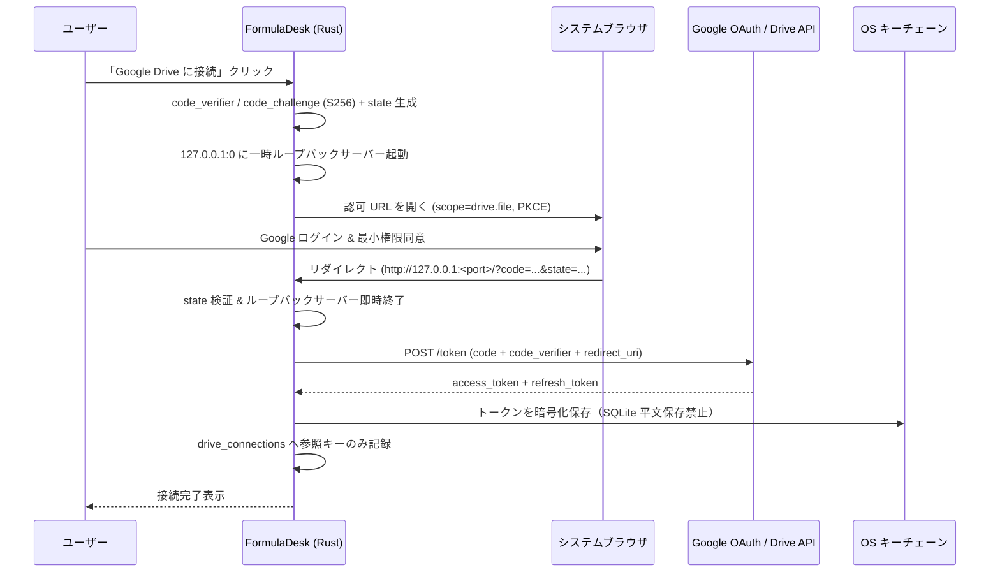
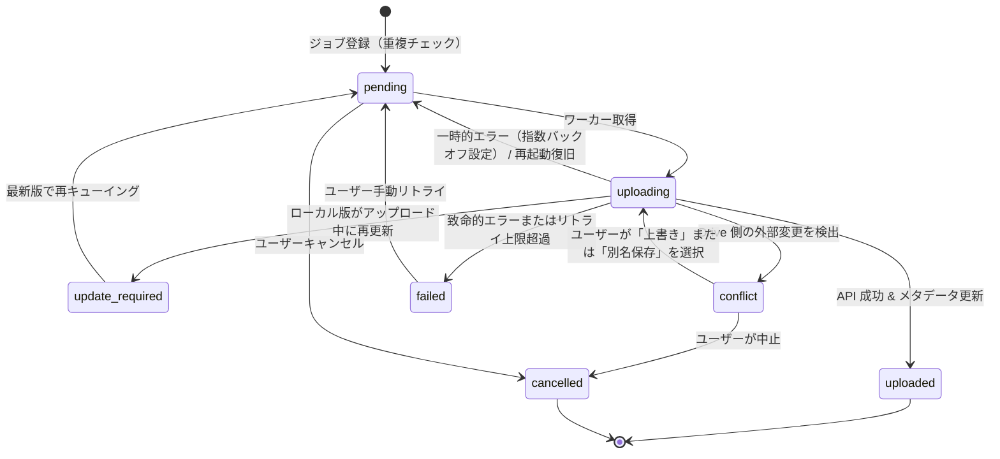

# Google Drive 連携仕様（Google Drive Integration）

> **ステータス**: Implemented v1.1（Phase 4 実装・Mock Google OAuth/Drive API v3 統合自動検証完了；実 Google アカウント OAuth 検証はクライアント ID 未設定のため保留）
> **API**: Google Drive API v3 / OAuth 2.0 (Authorization Code Flow + PKCE)
> **最終更新**: 2026-11-26
> **補足**: アプリ改称後の既定ルートフォルダ名は `Theorem`、冪等識別用 `appProperties` キーは `theorem_idempotency_key` を使用する。

---

## 1. 基本方針

- **エクスポート・保管先であり端末間同期ではない**: Google Drive は問題ファイルと解答 PDF のアップロード・更新先として使用する。端末間の双方向同期や SQLite DB の自動同期は行わない。
- **ローカル正本**: すべての学習データの正本はローカルに存在する。
- **任意接続**: Google Drive 未接続でも、アプリのローカル機能および AI 機能は一切の制限なく利用できる。
- **独立性**: Google Drive 連携モジュールは AI エージェント層と完全に独立させ、AI エージェントに Drive の認証情報や操作権限を渡さない。
- **安全な削除方針**: ローカルで問題や解答を削除しても、Google Drive 上のファイルは自動削除しない。

---

## 2. OAuth 2.0 認証設計

### 2.1 認証構成

| 項目 | 仕様 |
|---|---|
| 認証プロトコル | Google OAuth 2.0 Authorization Code Flow + PKCE（`S256`） |
| クライアント種別 | Desktop App OAuth Client |
| ブラウザ起動 | OS 既定のシステムブラウザ（WebView 内ログインは使用しない） |
| コールバック受信 | 一時的なローカルループバック HTTP サーバー（`http://127.0.0.1:<ephemeral_port>`） |
| 要求スコープ | `https://www.googleapis.com/auth/drive.file` のみ（原則） |
| トークン保存先 | OS の安全な認証情報ストレージ（Windows Credential Manager / macOS Keychain / Linux Secret Service） |

### 2.2 認証シーケンス



### 2.3 スコープ設計と Google Cloud / 審査要件

- **`drive.file` スコープの優位性**:
  - アプリ自身が作成またはユーザーが明示選択したファイル・フォルダのみへアクセスを限定できるため、Google Drive 全体（`drive` / `drive.readonly`）への過剰権限を要求しない。
  - `drive.file` は **Non-sensitive scope** に分類されており、Restricted Scope に課される第三者セキュリティ監査（CASA 等）を回避しつつ OSS デスクトップアプリとして公開可能である。
  - ※`drive` や `drive.readonly` を 1 つでも混在させると審査区分が引き上がるため、追加してはならない。
- **既存フォルダの保存先指定**:
  - デフォルトではアプリが作成した `My Drive/FormulaDesk/` 配下を使用する。
  - ユーザーが既存の Drive フォルダを保存先に変更する場合は、`drive.file` スコープで許可される公式の手段（Google Picker 等の明示選択フロー、またはアプリ作成フォルダの再配置）のみを用いる。
- **Google Cloud 設定・OSS 公開時の運用ルール**:
  1. Google Cloud Console でプロジェクトを作成し、Google Drive API を有効化する。
  2. OAuth 同意画面を設定し、スコープに `https://www.googleapis.com/auth/drive.file` のみを登録する。
  3. 認証情報から「OAuth クライアント ID（デスクトップ アプリ）」を発行する。
  4. **実際の OAuth クライアント情報や利用者の認証情報をリポジトリへ絶対にコミットしない**。開発・セルフビルド時は環境変数または `.gitignore` 対象のローカル設定から注入し、公式バイナリ配布時のクライアント構成は Phase 6 で確定する。

---

## 3. アップロード対象と Drive フォルダ構成

### 3.1 アップロード対象分類

| 分類 | 対象 |
|---|---|
| **デフォルト対象** | 元の問題 PDF / 元の問題画像 / 最新の解答 PDF |
| **任意対象（設定で有効化）** | 過去バージョンの解答 PDF / 解答ソース（JSON・`.typ`） / 図・グラフ単体ファイル |
| **アップロード禁止** | SQLite データベース（`formuladesk.db`） / AI 会話履歴 / 認証情報 / エージェント設定 / ログファイル |

### 3.2 Drive フォルダ階層

ローカルの「科目 → 階層フォルダ → ドキュメント」構成を Google Drive 上へそのまま反映する。

```text
My Drive/
└── FormulaDesk/                  # 設定により変更可能
    ├── 大学数学/
    │   ├── 線形代数/
    │   │   └── 2026年度中間試験/
    │   │       ├── 問題.pdf
    │   │       └── 解答.pdf
    │   └── 微分積分/
    └── 大学物理/
        ├── 古典力学/
        └── 電磁気学/
```

---

## 4. アップロードモード・ファイル更新・バージョン管理

### 4.1 アップロードモード

| モード | 挙動 |
|---|---|
| **手動アップロード（デフォルト）** | ユーザーが明示的に「Drive へアップロード / 更新」を実行したときのみ処理する |
| **自動アップロード** | ユーザーが明示的に有効化した場合に限り、問題保存・解答 PDF 生成後に自動でジョブを投入する |
| **フォルダ単位自動アップロード** | `folders.auto_upload_drive = 1` が設定されたフォルダ配下のドキュメントのみ自動投入する |

### 4.2 同一ファイル ID による更新と共有リンク維持

- 初回アップロードは Drive API v3 の **`files.create`**（resumable / multipart upload）を使用する。
- 既存ファイルの更新は **`files.update`** を使用し、**同一の Google Drive ファイル ID を維持**することで、ユーザーが他者と共有している Drive リンクが途切れないようにする。
- **論理対象マッピング**:
  - `drive_files` テーブルにおいて `(connection_id, document_id, logical_role)`（例: `latest_solution_pdf`）と `drive_file_id` を紐付ける。
  - ローカルで解答が v1 → v2 へ更新され新しい `attachment_id` が生成されても、論理対象が `latest_solution_pdf` であれば既存 `drive_file_id` に対して `files.update` を実行する（ローカルファイル ID の変化だけを基準に新規作成しない）。

### 4.3 Drive 側バージョン管理ポリシー

ローカル側には常にすべての解答バージョンを保持した上で、Drive 側の扱いを選択できる。

1. **最新版のファイルを更新する（デフォルト）**: 同一 `drive_file_id` を `files.update` で上書き（Google Drive 自身の改訂履歴に過去版が残る）。
2. **新しいファイルとして保存する**: バージョン番号付きファイル名（例: `解答_v2.pdf`）で新規 `files.create`。
3. **指定した解答バージョンをアップロードする**: バージョン履歴画面から任意の過去バージョンを明示アップロード。

---

## 5. 永続ジョブキューと状態遷移

SQLite の `drive_upload_jobs` テーブルを用いて耐障害性のある非同期ジョブキューを実装する。

### 5.1 ジョブ状態遷移



### 5.2 冪等性と重複作成防止

1. **重複ジョブ抑止**: `(connection_id, document_id, logical_role)` に対しアクティブ（`pending` / `uploading`）なジョブは 1 件のみ許可する（部分ユニークインデックス）。
2. **通信断後の重複作成防止**:
   - 初回アップロード時に一意な `idempotency_key`（UUID）をジョブへ保存し、Google Drive ファイルの `appProperties.formuladesk_idempotency_key` および `appProperties.formuladesk_logical_key` へ付与する（または `files.generateIds` で Drive ID を事前取得する）。
   - アップロード送信直後に通信切断・アプリ終了が発生し再起動後に再試行する場合、まず `appProperties`（または事前取得 ID）で Drive 側に既に作成済みかを照会し、存在すれば新規作成せず `drive_files` を修復して完了扱いとする。
3. **指数バックオフ**: ネットワーク一時断・HTTP 429 / 5xx に対してはジッター付き指数バックオフ（例: 5s → 15s → 45s → 2m → 5m）で再試行する。

---

## 6. エラー・競合ハンドリング一覧

| 発生事象 | 検知方法 | アプリの振る舞い |
|---|---|---|
| ネットワーク切断 | `reqwest` 接続エラー | ジョブを `pending` に戻し指数バックオフ待機。オフライン状態を表示 |
| 認証期限切れ / 失効 | HTTP 401 / リフレッシュ失敗 | トークンリフレッシュ試行 → 失敗時は接続を `reauth_required` にし再認証ボタン表示 |
| API レート制限 | HTTP 429 / 403 (`rateLimitExceeded`) | `Retry-After` ヘッダまたは指数バックオフで待機 |
| **Drive ファイルの外部変更** | 更新前に `files.get(fields="md5Checksum,modifiedTime,version,trashed")` を取得し、保存済みの `remote_md5_checksum` / `remote_modified_time` / `remote_version` と不一致 | **無断上書きを中止**しジョブを `conflict` へ遷移。UI で「ローカルで上書き」「別ファイルとして保存」「キャンセル」をユーザーへ確認 |
| Drive ファイルの削除 | HTTP 404 または `trashed == true` | ユーザーへ通知し、新規アップロードとして再作成するか選択させる |
| 保存先フォルダの削除 | 親フォルダ 404 / `trashed == true` | フォルダ階層の再作成を確認・実行してからアップロード |
| アップロード中のアプリ終了 | 起動時に `status = 'uploading'` ジョブを検出 | `pending` へ戻し、`appProperties` で冪等確認のうえ自動復旧 |
| 重複アップロード | 対象 SHA-256 と `last_uploaded_sha256` が一致 | 無駄な API 呼び出しをスキップし最新済みと表示 |
| Drive ストレージ容量不足 | HTTP 403 (`storageQuotaExceeded`) | 自動リトライを止め、容量不足の明示的な日本語エラーを表示 |

---

## 関連ドキュメント

- [データベース設計（database.md）](./database.md)
- [セキュリティ設計（security.md）](./security.md)
- [ADR-0006: Google Drive エクスポートと drive.file スコープ](./adr/0006-google-drive-export-oauth-drive-file.md)
