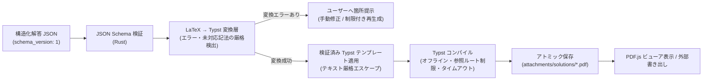

# PDF 生成・組版設計（PDF Generation）

> **ステータス**: Draft v1.0（組版実行方式と LaTeX→Typst 変換方式は Phase 0 で比較検証・確定）
> **組版エンジン**: Typst
> **最終更新**: 2026-11-25

---

## 1. 基本方針

- **TeX Live 不要**: ユーザーに数 GB 規模の TeX Live 環境インストールを要求せず、Typst を用いて高速かつ再現性の高い日本語・数式 PDF を生成する。
- **構造化データ駆動**: AI の自由記述テキストや AI 生成の任意 Typst コードをそのままコンパイルしない。必ず JSON Schema で検証された構造化解答データを受け取り、検証済みの Typst テンプレートへ安全に埋め込む。
- **内部数式形式の統一**: アプリ内部の共通数式表現は **LaTeX** とし、チャット描画（KaTeX）と解答 PDF（Typst 変換層経由）の双方で一貫性を保つ。

---

## 2. PDF 生成パイプライン



---

## 3. Phase 0 技術検証項目（実行方式と変換層）

### 3.1 Typst 実行方式の比較（Phase 0 で決定）

| 比較観点 | 案 A: Rust ライブラリ組み込み（`typst` crate） | 案 B: Typst CLI サイドカー実行 |
|---|---|---|
| 配布・単一バイナリ | Tauri バイナリへ統合でき配布が単純 | OS・アーキテクチャごとのサイドカー管理が必要 |
| クラッシュ・リソース隔離 | パニック・メモリ暴走がアプリ本体へ影響し得る | 子プロセス隔離によりタイムアウト・強制終了が容易 |
| コンパイル時間・バージョン追従 | `typst` crate の API 変更追従・Rust ビルド時間増 | 公式リリースバイナリの差し替えで追従容易 |
| フォント・パッケージ制御 | カスタム `World` 実装で厳密に制御可能 | `--root` / `--font-path` / オフライン指定で制御 |

MVP では **配布性・安定性・エラー処理・タイムアウト隔離** の観点から Phase 0 PoC の実測結果を踏まえて最終決定し、[ADR-0004](./adr/0004-typst-pdf-generation-and-latex-conversion.md) を `Accepted` へ更新する。

### 3.2 LaTeX → Typst 数式変換層の設計と検証

Typst は LaTeX とは異なる数式構文を使用する（例: `\frac{a}{b}` → `(a)/(b)`、`\sin\theta` → `sin theta`）。そのため **LaTeX 文字列をそのまま Typst 数式として埋め込んではならない**。

Phase 0 で以下を比較検証する。

1. **既存 Rust 変換ライブラリの評価**:
   - `mitex`（Rust ネイティブの高速 LaTeX パーサー/変換器。クレートまたは Typst パッケージとして利用可能）
   - `tex2typst`（読みやすい Typst 数式生成に特化した軽量変換器）
   - `tylax`（ドキュメント構造を含む変換器）
2. **制限付き数式 AST 変換層**:
   - 大学数学・大学物理で頻出する記法（行列 `pmatrix`/`bmatrix`、`cases`、偏微分 `\partial`、多重積分 `\iint`/`\oint`、ベクトル `\vec`/`\mathbf`、ブラケット記法 `\langle \psi | H | \phi \rangle`、総和・極限・集合記法、SI 単位 `\mathrm{m/s^2}` など）のテストスイートを用意し変換精度を検証する。
3. **変換失敗時の厳格な振る舞い**:
   - **未対応の数式記法を黙って削除したり、意味の異なる不正確な数式へ自動置換しない**。
   - 変換失敗箇所（ステップ番号・元の LaTeX 文字列・エラー理由）を構造化エラーとして返却し、解答エディタでのユーザー手動修正または AI による標準 LaTeX 記法への制限付き再生成フローを提供する。

---

## 4. 構造化解答データ仕様（Schema v1）

JSON Schema ファイルは `schemas/solution.v1.schema.json` に配置し、Rust 側で検証する。

### 4.1 共通・物理モデル例

```json
{
  "schema_version": 1,
  "problem_id": "550e8400-e293-41d4-a716-446655440000",
  "subject": "physics",
  "field": "classical_mechanics",
  "title": "斜面上の物体の運動",
  "mode": "detailed",
  "assumptions": ["摩擦を無視する", "重力加速度 g は一定とする"],
  "coordinate_system": "斜面下向きを x 軸の正、斜面に垂直上向きを y 軸の正とする",
  "given_quantities": [
    { "symbol": "m", "description": "物体の質量", "unit": "kg" },
    { "symbol": "\\theta", "description": "斜面の傾斜角", "unit": "rad" }
  ],
  "principles": ["ニュートンの運動方程式"],
  "steps": [
    { "type": "explanation", "text": "斜面方向の力のつり合いと運動方程式を立てる。" },
    { "type": "equation", "latex": "m a = m g \\sin\\theta", "display": true }
  ],
  "answer": {
    "latex": "a = g \\sin\\theta",
    "unit": "m/s^2"
  },
  "dimensional_check": {
    "note": "両辺の次元は L T^{-2} で一致する"
  },
  "limiting_cases": ["\\theta = 0 のとき a = 0、\\theta = \\pi/2 のとき自由落下 a = g"],
  "verification": [],
  "artifacts": [],
  "warnings": []
}
```

### 4.2 大学数学向け拡張フィールド

`subject == "mathematics"` の場合は以下のオプション要素を構造化保持できる。

- `definitions`: 使用する定義リスト（名称・数式・解説）
- `theorems`: 引用する定理・補題リスト（定理名・成立条件・適用理由）
- `proof`: 論理的証明ステップ配列（仮定・主張・導出・場合分け・Q.E.D.）
- `domain_and_boundary`: 変数の定義域・境界条件
- `alternative_solutions`: 別解リスト
- `counterexamples`: 反例（偽である命題・必要十分条件の反証時）

> **重要**: `verification` 配列内では、`source_kind: "ai_self_check"` と `source_kind: "science_mcp"` を明確に区別し、AI が出力した検証コメントを実際の計算ツール検証結果として表示しない。

---

## 5. PDF テンプレート設計

```text
templates/
├── common.typ          # 共通ページ設定（A4）、日本語フォント、見出し、数式ボックス、フッター/ページ番号
├── mathematics.typ     # 定義・定理・証明（Q.E.D.）・別解・反例レイアウト
├── physics.typ         # 与えられた物理量・座標系・仮定・次元確認・極限考察・図配置レイアウト
├── concise.typ         # 簡潔な模範解答向け省スペーステンプレート
└── detailed.typ        # 詳細解説・途中式・検証結果ボックス強調テンプレート
```

### 5.1 出力項目とメタデータ表示制御

- **標準項目**: タイトル、科目、問題番号、問題文、解答、途中式、証明、図・グラフ、使用した定理・物理法則、検証結果（実計算ツール結果の明示）、ページ番号
- **表示切替可能メタデータ**: 使用した AI モデル名、生成日時、解答バージョン番号（設定画面の「PDF 出力」カテゴリから非表示にできる）

---

## 6. 組版品質・フォント・セキュリティ要件

### 6.1 組版品質

- **用紙サイズ**: A4 をデフォルト（将来的に Letter / B5 を設定可能に拡張）。
- **日本語組版**: 日本語と欧文・数式が自然に調和する組版設定。再配布ライセンス（OFL 等）を確認した日本語フォント（例: Noto Serif JP / Noto Sans JP / BIZ UDP 等）を Phase 0 で選定・検証し、ライセンス文書を同梱する。
- **数式の可読性と改行**: 長い数式がページ幅からはみ出さないよう折り返し・複数行整列（`align` 相当）を考慮する。
- **図・グラフ**: Science MCP が生成する SVG（ベクター形式）を優先的に埋め込み、ラスター画像は 300 DPI 相当の解像度を確保する。
- **ページ跨ぎ**: 証明ブロックや解答途中での不自然な改ページ（見出し直後の孤立など）を避ける `breakable` / `sticky` 制御を行う。

### 6.2 PDF 生成時のセキュリティ

1. **任意 Typst コード実行禁止**: テンプレートへ流し込むテキスト・キャプション・メタデータはすべてエスケープし、Typst マークアップ/スクリプトインジェクション（`#read(...)` 等）を防止する。
2. **ファイル参照範囲の制限**: Typst コンパイル時のルートディレクトリを当該生成ジョブ専用の一時作業ディレクトリ（テンプレート＋当該解答のアーティファクトのみ）に限定し、上位ディレクトリや SQLite DB へのファイル参照を物理的に遮断する。
3. **ネットワーク・パッケージ取得の禁止**: コンパイル時に外部ネットワークから Typst パッケージを自動ダウンロードさせない（オフライン完結）。
4. **実行タイムアウト**: コンパイル処理に上限時間（例: 15〜30 秒）を設け、無限ループや過度なレイアウト計算によるハングを防ぐ。

---

## 関連ドキュメント

- [製品仕様書（product-specification.md）](./product-specification.md)
- [Science MCP Server 仕様（science-mcp.md）](./science-mcp.md)
- [セキュリティ設計（security.md）](./security.md)
- [ADR-0004: Typst PDF 生成と LaTeX 変換](./adr/0004-typst-pdf-generation-and-latex-conversion.md)
