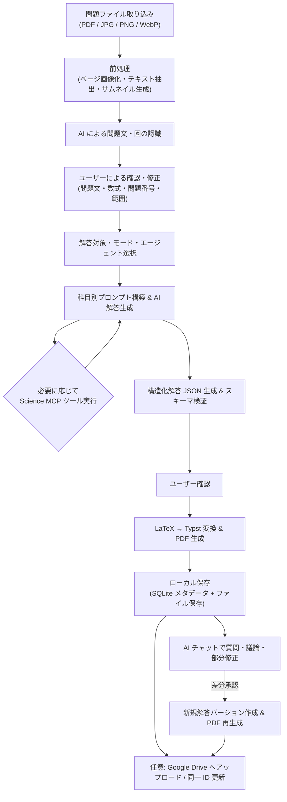

# FormulaDesk 製品仕様書（Product Specification）

> **ステータス**: Draft v1.0（Phase 0 技術検証前）
> **対象リポジトリ**: `Theorem` / アプリケーション仮称: `FormulaDesk`
> **最終更新**: 2026-11-25

---

## 1. 概要

### 1.1 アプリケーション名

**FormulaDesk**（仮称）

### 1.2 コンセプト

> **Open-source, local-first AI workspace for mathematics and physics.**

FormulaDesk は、大学数学・大学物理の学習に特化した、オープンソースかつローカルファーストなデスクトップアプリケーションである。
ユーザーが PDF や画像形式の問題を取り込むと、外部の公式 AI ハーネスと連携して問題文を認識し、途中式・論理的証明・図・グラフを含む解答を生成する。生成された解答は Typst によって高品質な PDF としてローカルに保存でき、ユーザーは問題や解答について AI と継続的に議論・検証・修正できる。

### 1.3 基本方針

| 項目 | 方針 |
|---|---|
| 公開形態・ライセンス | オープンソース（MIT ライセンス） |
| データ配置 | ローカルファースト（問題・解答・会話履歴の正本はローカルに保存） |
| サーバー構成 | 専用のバックエンドサーバーを必要としない |
| ユーザー管理 | アプリ独自のユーザー登録・アカウント管理を必要としない |
| AI 実行基盤 | 既存の公式 AI ハーネスを外部プロセスとして利用（独自ハーネスは作らない） |
| AI 課金・認証 | ユーザー自身の既存 AI サブスクリプション利用を優先し、プロバイダー規約を厳守する |
| プロバイダー依存 | 特定の AI プロバイダーに依存しない共通アダプター構成 |
| クラウド連携 | Google Drive への問題・解答ファイルのアップロードおよび同一 ID 更新に対応（任意接続） |
| 同期・モバイル | 端末間のデータ同期およびスマートフォン向けアプリは実装しない |

### 1.4 対応 OS

- **Windows 11**: 最優先（MVP のターゲット環境）
- **macOS**: 将来的に正式対応（Phase 6 で動作検証）
- **Linux**: 将来的に正式対応（Phase 6 で動作検証）

OS 固有の処理（パス解決、キーチェーン、プロセス管理、CLI 検出など）は抽象化層に閉じ込め、クロスプラットフォーム展開を阻害しない設計とする。

---

## 2. 想定ユーザーと学習ワークフロー

### 2.1 想定ユーザー

- 大学で数学・物理学を学ぶ学部生・大学院生
- 演習問題・過去問・講義レポートの解答整理、証明確認、数値・次元検証を体系的に行いたい学習者・研究者
- 既に契約している AI サブスクリプションやローカル CLI ツールを活用しつつ、学習資産（問題・解答・履歴）を自分の手元に保存・管理したいユーザー

### 2.2 エンドツーエンド学習ワークフロー

---

## 3. 機能仕様

### 3.1 問題ファイルの取り込みと前処理

- **対応形式**: `PDF`, `JPG` / `JPEG`, `PNG`, `WebP`（複数ファイル同時取り込み対応）
- **取り込み経路**:
  1. ファイル選択ダイアログ
  2. アプリ画面へのドラッグ＆ドロップ
  3. クリップボードからの画像貼り付け
- **取り込み処理手順**:
  1. ファイル形式（拡張子・マジックバイト）の検証
  2. ファイルサイズとページ数（PDF の場合）の確認
  3. UUID の発行と SHA-256 ハッシュ計算
  4. 既存ドキュメントとの重複検出・通知
  5. 元ファイルを変更せずアプリ管理領域（`attachments/originals/`）へアトミックにコピー
  6. SQLite へメタデータ登録
  7. サムネイル生成（`thumbnails/`）
  8. 問題ビューアへ表示
- **PDF 前処理（PDF.js）**:
  - ページ単位のテキスト抽出
  - ページ画像へのレンダリング
  - サムネイル生成
  - ページ範囲指定・特定領域の画像切り出し
  - 数式や物理図の欠落を防ぐためテキスト抽出結果だけに依存せず、画像入力非対応エージェントには無理に認識を実行させず切替を案内する。

### 3.2 ライブラリ・科目・フォルダ管理

- 科目（例: 大学数学、大学物理）および階層構造を持つフォルダで問題ドキュメントを整理できる。
- タグ、検索（Phase 5 で全文検索拡張）、最近開いた問題、お気に入り、Google Drive アップロード状態表示を提供する。

### 3.3 問題認識機能

AI を用いて問題ファイルから以下を構造化抽出する。

- 問題番号 / 小問番号
- 問題文 / 数式（LaTeX 形式）
- 掲載ページ番号 / 図・グラフの参照箇所
- 与えられた条件 / 求める対象
- 科目 / 分野

#### 認識モード

| モード | 内容 | 優先度 |
|---|---|---|
| 印刷問題のみ（デフォルト） | 印刷された問題文のみを抽出し、手書きの書き込み・解答を無視する | MVP |
| 手書き含む | 手書きの問題文・メモを含めて認識する | MVP |
| ページ・範囲指定 | 指定ページまたは切り出し領域のみ認識する | MVP |
| 手書き答案認識 | ユーザーの手書き答案を認識し添削へ渡す | Phase 5（将来拡張） |

- 判別できない箇所は推測で補完せず、「確認が必要な箇所（uncertain / warnings）」として明示記録する。
- ユーザーは解答生成前に、問題文・数式・問題番号・分割/結合・問題範囲・科目/分野・図の参照範囲を編集できる。

### 3.4 大学数学への対応

#### 対象分野（14 分野）

微分積分学 / 線形代数学 / 集合論 / 位相数学 / グラフ理論 / 離散数学 / 確率論 / 統計学 / 常微分方程式 / 偏微分方程式 / 複素解析 / 数論 / 抽象代数学 / 数値解析

#### 解答品質基準

- 数学的な厳密性、定義・定理の正確な引用、仮定の明示
- 途中式の省略を避けた導出、論理的な証明（結論のみの記述を禁止）
- 必要条件・十分条件の区別、変数の定義域・境界条件の明示
- 必要に応じた反例・別解の提示
- AI が確信を持てない場合の不確実性の明示

### 3.5 大学物理への対応

#### 対象分野（10 分野）

古典力学 / 解析力学 / 電磁気学 / 熱力学 / 統計力学 / 量子力学 / 波動 / 光学 / 流体力学 / 特殊相対性理論

#### 解答構成要素（問題の性質に応じて選択適用）

1. 問題の整理 / 2. 与えられた物理量 / 3. 求める物理量 / 4. 仮定・近似条件 / 5. 座標系と符号規約 / 6. 使用する物理法則 / 7. 運動方程式等の立式 / 8. 数式の導出 / 9. 初期条件・境界条件の適用 / 10. 最終結果 / 11. 単位と次元の確認 / 12. 極限の場合の確認 / 13. 物理的な意味・考察 / 14. 必要な図やグラフ

- SI 単位系をデフォルトとするが、問題文で指定された単位系を優先する。
- 使用した物理定数の値・単位・近似条件を明示する。

#### 図・グラフ対応

- **MVP 優先**: 関数グラフ、数値データグラフ、基本的な物理図
- **将来拡張（Phase 5 以降）**: 力のベクトル図、自由物体図、電気回路図、電場・磁場、ベクトル場、波動、ポテンシャルエネルギー、運動の軌跡

### 3.6 解答生成機能と構造化スキーマ

#### 解答生成モード

| モード | 内容 | 優先度 |
|---|---|---|
| `standard` | 通常の解答 | MVP |
| `detailed` | 詳細な途中式・解説 | MVP |
| `rigorous` | 厳密な証明・導出 | MVP |
| `hint` | 解答を明示せずヒントを提示 | MVP |
| `concise` | 簡潔な模範解答 | Phase 2/5 |
| `beginner` | 初学者向けの噛み砕いた解説 | Phase 5 |
| `verified` | 計算ツールによる検証を重点的に実施 | Phase 3 |
| `review` | ユーザーの答案を添削 | Phase 5 |

#### 生成対象

- 問題ファイル内の全問題 / 指定した問題番号 / 指定した小問 / 指定したページ範囲
- すべてユーザーの明示的な操作を起点として開始する（利用条件未確認の無人バッチ処理は禁止）。

#### 構造化解答データ（Schema v1）

AI 応答を直接 PDF へ変換せず、JSON Schema で検証可能な構造化データとして保持する。全データに `schema_version` を付与し、不正 JSON が返却された場合はユーザー修正または制限付き再生成へ誘導する。AI が出力した検証コメントと Science MCP ツールによる実計算検証は厳密に区別する。詳細は [pdf-generation.md](./pdf-generation.md) を参照。

### 3.7 AI チャットと解答部分修正

- チャットスレッドは「問題ドキュメント / 個別問題 / 解答バージョン」に関連付ける。
- コンテキスト（元画像、認識問題文、対象問題番号、現在/過去の解答、計算結果、会話履歴、参考資料）は必要最小限のみ送信する。
- 会話履歴の正本は SQLite とし、アプリ再起動後も閲覧可能。ハーネスがセッション再開に対応していれば公式機能を利用し、非対応やエージェント切替時は必要履歴を引き継いで継続する。
- **解答の部分修正（Phase 5）**: 修正指示 → AI 変更案生成 → 既存解答との差分表示 → ユーザー承認/拒否 → 承認分のみ適用 → 新規解答バージョン作成 → PDF 再生成。過去バージョンの上書きおよび他問題への意図しない変更を禁止する。

### 3.8 AI ハーネス統合

- OpenAI Codex（Codex App Server）、Anthropic Claude Code（公式プロセス / SDK / ACP）、Google Antigravity（公式 ACP）、カスタム ACP エージェントを共通 `AgentAdapter` 層で統合する。
- 用途別（問題認識・解答生成・AI チャット・解答検証・解答修正）にエージェントを設定可能とし、初期デフォルトは単一エージェントとする。
- 詳細は [agent-integration.md](./agent-integration.md) および [provider-compatibility.md](./provider-compatibility.md) を参照。

### 3.9 Science MCP Server

- Python（`uv` 管理）でローカル MCP サーバーを実装し、SymPy / NumPy / SciPy / Pint / Matplotlib による記号・数値計算、単位・次元解析、グラフ生成を提供する。
- 任意の Python コード実行は一切許可せず、安全な数式パーサー・実行時間/メモリ/出力先制限を設ける。
- 詳細は [science-mcp.md](./science-mcp.md) を参照。

### 3.10 PDF 生成（Typst）

- 構造化解答データを LaTeX → Typst 変換層および検証済みテンプレート経由で PDF 化する（TeX Live 等の大規模環境は不要）。
- 日本語組版・A4 デフォルト・数式可読性・ベクターグラフ埋め込み・メタデータ表示切替に対応する。
- 詳細は [pdf-generation.md](./pdf-generation.md) を参照。

### 3.11 Google Drive 連携

- ローカル正本の問題ファイル・最新解答 PDF を Google Drive へアップロードおよび同一ファイル ID で更新できる（任意接続）。
- OAuth 2.0 + PKCE + `drive.file` 最小スコープ、SQLite 永続ジョブキュー、競合検出を実装する。
- 詳細は [google-drive.md](./google-drive.md) を参照。

---

## 4. MVP 完成条件

以下の全 19 項目を満たした時点を MVP 完成とする。

1. Windows でアプリを起動できる。
2. PDF・画像を取り込める。
3. 科目・フォルダごとに問題を管理できる。
4. 元の問題ファイルを閲覧できる。
5. 少なくとも 1 つの公式 AI ハーネスに接続できる。
6. 許可された認証方式で AI を利用できる。
7. 大学数学・大学物理の問題を認識できる。
8. 認識結果を修正できる。
9. 解答を生成できる。
10. 数式を含む日本語の解答 PDF を出力できる。
11. 問題や解答について AI に質問できる。
12. AI の応答がストリーミング表示される。
13. 処理をキャンセルできる。
14. 会話履歴をローカルに保存できる。
15. 解答をバージョン管理できる。
16. 基本的な数学・物理計算ツールを使用できる。
17. Google Drive へ問題・解答をアップロードできる。
18. Google Drive の既存ファイルを更新できる。
19. アプリ再起動後もデータを保持できる。

> **プロバイダー対応方針**: Codex・Claude Code・Antigravity の 3 種類対応は正式版の重要要件とするが、特定プロバイダーに規約・技術障壁がある場合は問題のないエージェントで MVP 開発を継続し、未実装・未検証プロバイダーを動作確認済みとして表示しない。

---

## 5. スコープ外（Non-Goals）

- 独自バックエンドサーバーやクラウドデータベースの構築
- ユーザーアカウント登録・ログイン基盤の提供
- 端末間の双方向データ同期（SQLite ファイルの自動クラウド同期を含む）
- スマートフォン（iOS / Android）向けアプリ
- コーディングエージェント汎用 IDE の再現
- 公式 AI ハーネスの改変・非公開 API 利用・認証トークンの非公式抽出・利用制限回避
- 汎用 Python コード実行環境の提供

---

## 関連ドキュメント

- [要件定義書（requirements.md）](./requirements.md)
- [システムアーキテクチャ（architecture.md）](./architecture.md)
- [UI/UX 設計（ui-design.md）](./ui-design.md)
- [開発ロードマップ（roadmap.md）](./roadmap.md)
