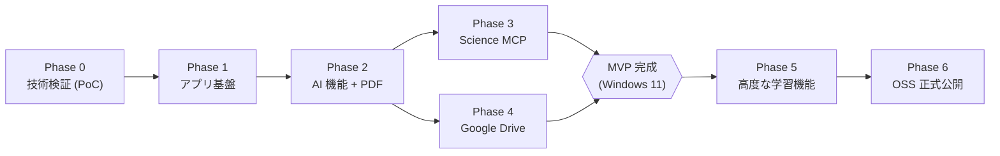

# 開発ロードマップ（Roadmap）

> **ステータス**: Active v1.1
> **対象**: Phase 0（技術検証）〜 Phase 6（OSS 正式公開）
> **最終更新**: 2026-11-26

---

## 1. フェーズ全体像

- **MVP 範囲**: Phase 0 〜 Phase 4（[product-specification.md](./product-specification.md) の MVP 完成条件 19 項目をすべて満たす）
- **正式公開範囲**: Phase 5 〜 Phase 6（高度な学習機能、3 大 AI ハーネス正式対応、クロスプラットフォーム、配布・日英対応）

---

## 2. フェーズ別詳細計画と GitHub Issue 対応表

| Phase | 名称 | 区分 | 目的・主要スコープ | GitHub Issue | ステータス |
|---|---|---|---|---|---|
| **Phase 0** | 技術検証（PoC） | PoC | AI ハーネス接続・認証/規約確認、Typst PDF・LaTeX 変換、Google Drive OAuth/更新の実行可能 PoC と技術選定確定 | [#1](https://github.com/sskohei/Theorem/issues/1) | PoC 完了（一部外部認証保留） |
| **Phase 1** | アプリ基盤 | MVP | Tauri v2 + React 3 カラム UI、SQLite、ローカルファイル管理、科目/フォルダ、PDF.js・画像ビューア、問題インポート | [#2](https://github.com/sskohei/Theorem/issues/2) | 実装・ローカル検証完了 |
| **Phase 2** | AI 機能 | MVP | `AgentAdapter`・Agent Manager、Codex/Claude/Antigravity/ACP 連携、設定画面、問題認識・編集、解答生成・構造化、AI チャット・履歴・セッション、Typst PDF 生成、バージョン管理 | [#3](https://github.com/sskohei/Theorem/issues/3) | 未着手 |
| **Phase 3** | 数学・物理計算ツール | MVP | Python (`uv`) Science MCP Server（SymPy/Pint/NumPy/Matplotlib）、安全パーサー、計算結果保存、数式検証、次元解析、グラフ生成と PDF 埋め込み | [#4](https://github.com/sskohei/Theorem/issues/4) | 未着手 |
| **Phase 4** | Google Drive 連携 | MVP | OAuth 2.0 PKCE (`drive.file`)、接続管理、フォルダ作成、問題・解答アップロード、同一 ID 更新、状態表示、永続ジョブキュー、指数バックオフ再試行、競合検出 | [#5](https://github.com/sskohei/Theorem/issues/5) | 未着手 |
| **Phase 5** | 高度な学習機能 | Post-MVP | チャットによる解答部分修正・差分承認、AI 答案添削、講義資料参照、複数 AI 解答比較、高度な物理図、学習ステータス、全文検索、お気に入り | [#6](https://github.com/sskohei/Theorem/issues/6) | 未着手 |
| **Phase 6** | OSS 正式公開 | Release | Windows インストーラー、macOS/Linux 動作検証、Python/Typst 配布方式確定、ライセンス確認、README/CONTRIBUTING/SECURITY 整備、GitHub Actions、初回リリース、日英対応 | [#7](https://github.com/sskohei/Theorem/issues/7) | 未着手 |

---

## 3. 各フェーズの完了条件（Definition of Done）

### Phase 0：技術検証（PoC）

- AI ハーネス（12 項目）、PDF/Typst（6 項目）、Google Drive（4 項目）について実行可能な PoC と検証結果レポートが作成されている。
- 各項目が `動作確認済み` / `未検証` / `対応不可` / `利用条件の確認が必要` / `代替手段` / `技術的リスク` として [implementation-status.md](./implementation-status.md) と [provider-compatibility.md](./provider-compatibility.md) に正確に記録されている。
- 外部認証が必要な検証を認証情報なしで成功扱いにしていない。
- Typst 実行方式および LaTeX→Typst 変換方針が [ADR-0004](./adr/0004-typst-pdf-generation-and-latex-conversion.md) に確定記録されている。

### Phase 1：アプリ基盤

- Windows 11 で Tauri v2 アプリが起動し、3 カラムレイアウト（リサイズ・開閉・ライト/ダーク対応）が動作する。
- PDF / JPG / PNG / WebP のインポート（ダイアログ・D&D・クリップボード・複数ファイル・重複検出・原本不変）と SQLite 永続化が動作し、アプリ再起動後も保持される。
- 科目・階層フォルダ管理、PDF.js ビューア、画像ビューアが動作し、Rust/React の単体テスト・lint・clippy が通過する。

### Phase 2：AI 機能

- **最重要マイルストーン**: Phase 2 完了時点で、**少なくとも 1 つの対応公式 AI ハーネスを用いた基本学習ワークフロー（問題取り込み → 認識 → 編集 → 解答生成 → 日本語・数式入り PDF 出力 → AI チャット質問・ストリーミング・キャンセル → 会話履歴保存 → 解答バージョン管理）が一貫して動作する**。
- 許可された認証方式のみ有効化され、未検証プロバイダーを動作確認済み表示していない。
- Mock Adapter による CI 自動テストと、利用可能な実ハーネスによる検証結果が区別して記録されている。

### Phase 3：数学・物理計算ツール

- Science MCP Server が MVP ツール（微分・積分・方程式・行列・次元解析・単位変換・関数グラフ）を提供し、安全な AST 数式パーサー・タイムアウト・出力先制限が `pytest` で検証されている。
- AI エージェント経由のツール実行結果・検証結果（5 状態）・生成グラフが SQLite および UI「計算結果」タブに保存表示され、解答 PDF へグラフを埋め込める。

### Phase 4：Google Drive 連携（MVP 完成マイルストーン）

- `drive.file` スコープの OAuth 2.0 + PKCE 認証と OS キーチェーン保管が動作する（未接続でも他機能は正常動作）。
- 問題・最新解答 PDF のアップロード、同一 Drive ファイル ID 維持による更新、永続ジョブキュー・指数バックオフ再試行・再起動復旧・外部変更競合検出が動作する。
- **MVP 完成条件 19 項目すべて**の達成をテストおよび実機チェックリストで確認し記録する。

### Phase 5：高度な学習機能

- チャットからの部分修正（差分作成 → ユーザー承認 → 新規バージョン作成 → PDF 再生成、他問題非改変）が動作する。
- 手書き/ユーザー答案添削、講義資料参照、複数 AI 比較（規約確認済み範囲）、高度な物理図、学習ステータス、全文検索、お気に入り、問題/解答並置表示が実装・テストされている。

### Phase 6：OSS 正式公開

- Windows インストーラーのビルドおよび配布手順が整備され、macOS・Linux での動作検証結果が記録されている。
- Python ランタイム・Typst・日本語フォントおよび全依存ライブラリの配布方式とライセンス適合性が確定している。
- `README.md` / `README.ja.md` / `CONTRIBUTING.md` / `SECURITY.md` / `AGENTS.md`、GitHub Actions（CI & Release）、日英 UI 対応が完了し、初回 OSS リリースを作成できる状態にある。

---

## 4. 主要リスクとフェーズ別緩和計画

| リスク | 影響フェーズ | 緩和策 |
|---|---|---|
| プロバイダーごとのサブスクリプション利用規約制約（特に Claude Code 等） | Phase 0 / 2 | 机上調査でリスクを先行記録済み。Phase 0 で最新規約を再確認し、問題のないハーネスで MVP を推進。API キー代替は明示的同意制。 |
| LaTeX → Typst 変換の複雑数式エッジケース | Phase 0 / 2 | Phase 0 で `mitex` 等を大学数学・物理数式コーパスで検証。未対応記法は黙殺せず箇所提示＋手動修正/再生成導線を確保。 |
| Windows 環境での外部 CLI・Python (`uv`)・Typst 配布複雑性 | Phase 0 / 3 / 6 | Phase 0 で依存方式を検証し、MVP は開発者/ユーザー環境またはサイドカーで安定稼働を優先、Phase 6 で配布パッケージングを確定。 |
| AI エージェントによる権限逸脱・プロンプトインジェクション | Phase 0 / 2 / 3 | 隔離ワークスペース＋任意シェル禁止＋MCP AST パーサー＋DB/Drive 分離の多層防御を初期から組み込む。 |

---

## 関連ドキュメント

- [製品仕様書（product-specification.md）](./product-specification.md)
- [実装・検証状況（implementation-status.md）](./implementation-status.md)
- [ADR 一覧（adr/README.md）](./adr/README.md)
