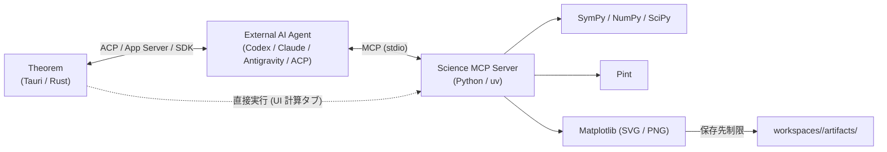

# Science MCP Server 仕様書（Science MCP）

> **ステータス**: Implemented v1.1（Phase 3 実装・ローカル自動テスト・実機 Codex 連携検証済み）
> **実装言語・環境**: Python 3.11+（`uv` + `pyproject.toml` + `uv.lock`） / MCP Python SDK v2（`mcp.server.mcpserver.MCPServer`）
> **最終更新**: 2026-11-26

---

## 1. 概要と責務分離

Science MCP Server は、大学数学・大学物理の記号計算、数値計算、単位変換、次元解析、グラフ生成を安全に実行するローカル MCP（Model Context Protocol）サーバーである。

### 通信プロトコルの分離



- **ACP / App Server / SDK**: Theorem 本体と AI エージェント間の通信
- **MCP**: AI エージェント（または UI 直接実行）と数学・物理計算ツール間の通信
- **グローバル設定保護**: ユーザーの既存グローバル MCP 設定（`~/.codex/config.toml`、`~/.claude.json` 等）を無断変更せず、Theorem が起動するセッション単位で安全に `science_mcp` を登録する。

---

## 2. 使用ライブラリ

| ライブラリ | 用途 |
|---|---|
| MCP Python SDK (`mcp`) | MCP サーバー実装（`stdio` トランスポート、スキーマ定義） |
| SymPy | 記号計算（簡約、展開、因数分解、微積分、極限、方程式、ODE、行列演算） |
| NumPy / SciPy | 数値評価、数値積分・求根、行列数値計算、データ生成 |
| Pint | SI 単位系・物理定数・単位変換・次元解析 |
| Matplotlib | 関数グラフ・データ可視化・ベクトル場（SVG 優先 / 高解像度 PNG、非対話バックエンド `Agg`） |

依存関係は `science-mcp/pyproject.toml` および `uv.lock` で固定管理し、コード品質は `Ruff` と `pytest` で検証する。

---

## 3. 提供ツール一覧（全 21 ツール）

### 3.1 MVP 優先ツール（Phase 3 初期実装）

| カテゴリ | ツール名 | 内容 | 主な入力 | 主な出力 |
|---|---|---|---|---|
| 代数・方程式 | `solve_equation` | 方程式の求解 | `equation`, `variable`, `domain` | 解リスト（LaTeX + 文字列表現）、仮定 |
| 微積分 | `differentiate` | 微分（高階・偏微分） | `expression`, `variable`, `order` | 導関数（LaTeX + 文字列） |
| 微積分 | `integrate` | 不定積分・定積分 | `expression`, `variable`, `lower`, `upper` | 積分結果（LaTeX + 文字列）、収束条件 |
| 線形代数 | `calculate_determinant` | 行列式 | `matrix` | 行列式（LaTeX + 数値/記号値） |
| 線形代数 | `calculate_inverse_matrix` | 逆行列 | `matrix` | 逆行列（特異行列時は明示エラー） |
| 線形代数 | `matrix_operation` | 行列加減乗・転置・階数・トレース | `operation`, `matrices` | 結果行列またはスカラー |
| 検証 | `verify_equation` | 条件付き等式検証（記号差簡約＋数値サンプリング） | `lhs`, `rhs`, `assumptions` | `status` (`passed`/`failed`/`inconclusive`), 検証根拠 |
| 物理・単位 | `convert_units` | 単位変換 | `value`, `from_unit`, `to_unit` | 変換後数値・単位・SI 表現 |
| 物理・単位 | `check_dimensions` | 次元解析（左辺・右辺の次元一致確認） | `expressions_with_units` または `lhs_dim`/`rhs_dim` | 次元一致可否、`[M][L][T]...` 表現 |
| 可視化 | `plot_function` | 1 変数関数グラフ生成 | `expressions`, `x_range`, `labels`, `format` | 出力アーティファクト相対パス（SVG/PNG）、メタデータ |

### 3.2 拡張ツール（Phase 3 後半〜Phase 5）

| カテゴリ | ツール名 | 内容 |
|---|---|---|
| 代数 | `simplify_expression` | 数式の簡約 |
| 代数 | `expand_expression` | 数式の展開 |
| 代数 | `factor_expression` | 因数分解 |
| 微積分 | `calculate_limit` | 極限計算（片側極限対応） |
| 方程式 | `solve_system` | 連立方程式の求解 |
| 微分方程式 | `solve_ode` | 常微分方程式（初期条件・境界条件対応） |
| 線形代数 | `calculate_eigenvalues` | 固有値計算 |
| 線形代数 | `calculate_eigenvectors` | 固有ベクトル計算 |
| 数値計算 | `numerical_evaluate` | 高精度数値評価（任意精度/浮動小数） |
| 可視化 | `plot_data` | 測定・数値データの散布図/折れ線グラフ |
| 可視化 | `plot_vector_field` | 2D ベクトル場（電場・速度場等）の可視化 |

---

## 4. セキュリティ設計（最重要）

AI エージェントが問題 PDF 内のプロンプトインジェクションを受けた場合、悪意ある文字列が計算ツール引数として渡される可能性がある。そのため Science MCP Server は**すべての入力を信頼できないデータとして防御**する。

### 4.1 任意コード実行（RCE）の完全禁止

1. **汎用 Python 実行ツールを一切提供しない**（`run_python` 等のツールは設計上禁止）。
2. **`eval()` / `exec()` / `compile()` および `sympy.lambdify()` を使用しない**（グラフ描画時も SymPy AST を再帰的に NumPy 配列演算へ評価する専用評価器を使用し、プロダクションコード全域で AST 静的テストにより禁止を強制する）。
3. **SymPy `parse_expr()` の無防備な呼び出しを禁止する**:
   - SymPy の `parse_expr()` は内部的に `eval()` を用いるため、`local_dict` 指定だけでは `__import__('os').system(...)` 等の組込関数経由 RCE を防げない。
   - 対策として、専用モジュール `science_mcp/parser.py` にて **Python `ast.parse(..., mode='eval')` による厳格なホワイトリスト AST 検証**を行い、許可されたノード・演算子・関数名・シンボル名のみから直接 SymPy オブジェクト（`Symbol`, `Add`, `Mul`, `Pow`, `sin`, `cos`, `exp`, `log`, `sqrt` 等）を構築する（`parse_expr` に生文字列を直接渡さない）。
   - アンダースコア始まり識別子（`__builtins__`, `__class__` 等）、属性アクセス（`ast.Attribute`）、ラムダ、内包表記、インポート、任意の添字アクセスは AST 段階で即座に拒否する。

### 4.2 許可される数式要素の例

- **リテラル**: 整数・浮動小数（桁数・指数上限あり）
- **定数**: `pi`, `E` (`e`), `I` (`i`), `oo`
- **演算子**: `+`, `-`, `*`, `/`, `**`（指数上限チェックあり：例 `10**1000000` によるメモリ枯渇 DoS 防止）
- **関数（明示ホワイトリスト）**: `sin`, `cos`, `tan`, `asin`, `acos`, `atan`, `sinh`, `cosh`, `tanh`, `exp`, `log`, `ln`, `sqrt`, `Abs`, `factorial`（上限付き）, `floor`, `ceiling`, `re`, `im`, `conjugate`
- **変数**: 英字・数字・添字文字の短い識別子（予約語・`__` 禁止）

### 4.3 リソース制限・タイムアウト・出力先制限

| 防御項目 | 制御内容 |
|---|---|
| 入力サイズ制限 | 数式文字列長上限（例: 2,048 文字）、AST ノード数上限（例: 256）、行列サイズ上限（例: 20×20） |
| 実行時間制限 | ツール呼び出しごとにハードタイムアウト（デフォルト例: 10 秒、設定変更可）。タイムアウト時はワーカーサブプロセスを強制終了し `status: "timeout"` を返却 |
| メモリ制限 | 計算を独立ワーカープロセスで実行し、メモリ上限（OS 機能 / 入力制限併用）を超過した計算からサーバー本体を保護 |
| 出力ファイル制限 | Matplotlib の保存先はサーバー起動時に環境変数/引数で固定された単一の `artifacts/` ディレクトリ配下のみ。ファイル名はサーバー側で UUID 生成し、ユーザー/AI 指定パスは一切受け付けない（パストラバーサル完全防止） |
| 非対話描画 | `MPLBACKEND=Agg` を強制し、GUI ウィンドウ生成を防止 |
| ネットワーク非依存 | Science MCP Server 自体は外部ネットワーク通信を一切行わない |

---

## 5. 共通レスポンス形式と検証ステータス

### 5.1 ツール共通出力エンベロープ

```json
{
  "ok": true,
  "tool": "integrate",
  "result": {
    "expression": "x**3 / 3",
    "latex": "\\frac{x^{3}}{3}",
    "numeric": null
  },
  "verification": {
    "status": "passed",
    "target": "不定積分の微分検算",
    "assumptions": ["x is real"],
    "method": "sympy.diff(result, x) - integrand == 0"
  },
  "artifacts": [],
  "warnings": [],
  "duration_ms": 42
}
```

### 5.2 検証ステータス定義（5 状態）

| ステータス | 意味 |
|---|---|
| `passed` | 指定した対象・仮定・手法の範囲で計算ツールによる検証に合格 |
| `failed` | 計算ツールにより不一致・次元不整合・反例を検出 |
| `inconclusive` | 記号簡約で決定不能・定義域条件不足などにより判定不能 |
| `not_run` | 計算ツール検証が未実行 |
| `error` | 構文エラー・タイムアウト・数値オーバーフロー等で検証処理自体が失敗 |

> **検証の限界に関する原則**: 計算ツールによる `passed` は「指定された式変形・数値・次元等の局所的整合性」を示すものであり、**数学的証明全体の妥当性や物理モデル・近似の妥当性を保証するものではない**。UI および PDF 上でも「検証対象・仮定・手法」と併せて正確に表示し、AI 自身の自己チェック出力と混同しない。

---

## 6. ディレクトリ・モジュール構成

```text
science-mcp/
├── pyproject.toml
├── uv.lock
├── src/
│   └── science_mcp/
│       ├── __init__.py
│       ├── models.py           # 共通出力エンベロープ・5 状態検証・セキュリティ上限定数
│       ├── server.py           # MCP エントリポイント（全 21 ツール登録・stdio 配信）
│       ├── parser.py           # AST ホワイトリストによる安全な数式パーサー
│       ├── runner.py           # spawn ワーカープロセス隔離＋ハードタイムアウト実行基盤
│       └── tools/
│           ├── algebra.py
│           ├── calculus.py
│           ├── linear_algebra.py
│           ├── differential_equations.py
│           ├── dimensions.py
│           └── plotting.py
└── tests/
    ├── test_parser_security.py # RCE / インジェクション / DoS / AST 禁止関数チェック
    ├── test_algebra.py
    ├── test_calculus.py
    ├── test_linear_algebra.py
    ├── test_dimensions.py
    ├── test_plotting.py
    ├── test_timeout.py
    └── test_mcp_stdio.py       # 実 stdio JSON-RPC ハンドシェイク・21 ツール登録検証
```

---

## 関連ドキュメント

- [セキュリティ設計（security.md）](./security.md)
- [AI ハーネス統合設計（agent-integration.md）](./agent-integration.md)
- [テスト方針（testing.md）](./testing.md)
- [ADR-0005: Science MCP Server（Python / uv）](./adr/0005-science-mcp-server-python-uv.md)
