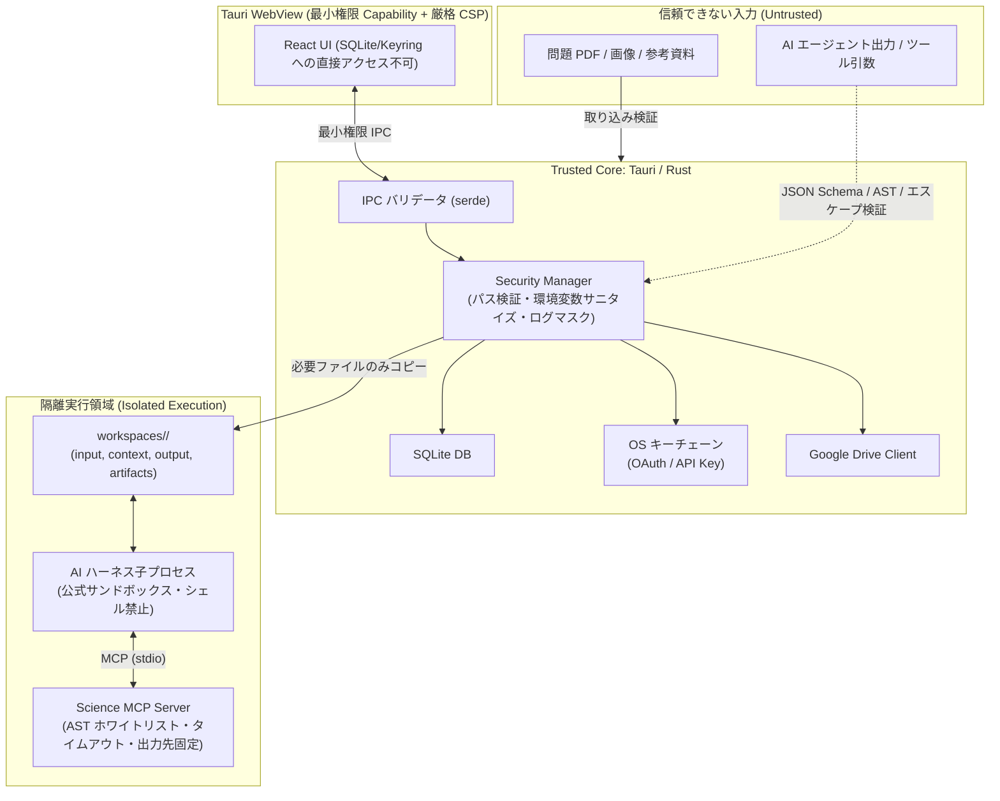

# セキュリティ・プライバシー設計（Security）

> **ステータス**: Draft v1.0
> **最終更新**: 2026-11-25

---

## 1. セキュリティ境界と権限モデル

FormulaDesk はローカル環境で外部 AI ハーネスおよび計算ツールを実行するため、**信頼境界（Trust Boundary）**を厳格に設計し、多層防御（Defense in Depth）を適用する。



### 絶対的なアクセス分離ルール

- AI エージェントに **SQLite データベースへの直接アクセス**を許可しない。
- AI エージェントに **Google Drive の操作権限や認証トークン**を一切渡さない。
- AI エージェント子プロセスへ **不要な環境変数**（`OPENAI_API_KEY` の無断継承、Google OAuth 情報、AWS/SSH 認証系環境変数等）を引き継がない。
- React（WebView）から SQLite や OS キーチェーンを直接操作させず、Rust 側の検証済みコマンドのみを公開する。

---

## 2. 脅威モデルと対策マトリクス

| 脅威カテゴリ | 想定攻撃・リスクシナリオ | 対策 |
|---|---|---|
| **プロンプトインジェクション** | 問題 PDF・画像・参考資料に「システム設定を変更せよ」「認証トークンを読め」「シェルコマンドを実行せよ」等の隠し命令が含まれる | 問題文・画像・参考資料・AI 出力をすべて非信頼データとして扱う。任意シェル禁止・領域制限・DB/Drive 隔離・JSON Schema 検証・ユーザー承認なしの破壊的操作禁止により、インジェクションが成立しても被害を実行不可にする。 |
| **エージェント権限逸脱** | AI ハーネスがワークスペース外の個人ファイルを読取・削除する、または任意コマンドを実行する | 1. セッション専用ワークスペース `workspaces/<session-uuid>/` を作成。<br/>2. 作業ディレクトリ指定だけに依存せず、各ハーネスの公式サンドボックス・権限フック（`PermissionRequested`）・OS レベルの権限制御を併用。<br/>3. 任意シェル実行はデフォルト禁止。<br/>4. **必須の安全制限を提供できないエージェントについては該当機能を無効化する**。 |
| **Science MCP RCE / DoS** | AI が計算ツール引数に `__import__('os').system(...)` や `10**10000000` を渡す | 汎用 Python 実行ツールを実装しない。`eval`/`exec` および生 `sympy.parse_expr` 呼び出しを禁止し、Python `ast` ホワイトリストパーサーを使用。入力長・AST 深さ・指数上限・ワーカープロセス隔離・ハードタイムアウト・固定出力ディレクトリを強制。 |
| **Typst コードインジェクション** | AI 生成解答に含まれる文字列が `#read("/etc/passwd")` 等として Typst に解釈される | AI 生成の任意 Typst コードを実行しない。構造化 JSON のみを受け取り、検証済みテンプレートへ全テキストを厳格エスケープして埋め込む。コンパイル参照ルートを一時作業ディレクトリに限定し、外部パッケージ取得禁止・タイムアウト設定。 |
| **パストラバーサル / シンボリックリンク攻撃** | `../../` やシンボリックリンク経由でアプリ管理領域外のファイルを読み書き・削除させる | Rust `security/path.rs` でルートディレクトリ配下への解決（`canonicalize` およびコンポーネント検証）を必須化し、シンボリックリンクによる管理領域外参照を拒否する。 |
| **WebView XSS / IPC 悪用** | Markdown・数式・PDF レンダリング時の XSS により Tauri IPC が悪用される | `react-markdown` で生 HTML 描画を禁止（サニタイズ徹底）。`tauri.conf.json` で厳格な CSP を設定し外部スクリプトを遮断。Tauri v2 Capability を最小権限・`main` ウィンドウ限定で定義。 |
| **認証情報漏洩** | SQLite・`settings.json`・ログ・Git コミットから OAuth トークンや API キーが漏洩する | 認証情報は OS キーチェーンへ保存し SQLite には参照キーのみ記録。構造化ログの秘匿フィルタリングを強制。開発・テスト・本番でキーチェーンサービス名を分離。`.gitignore` とレビューでシークレットコミットを防止。 |

---

## 3. エージェント実行ワークスペース隔離設計

セッションごとに以下の独立ディレクトリを作成する。

```text
FormulaDesk/workspaces/
└── <session-uuid>/
    ├── input/                  # 当該処理に必要な問題 PDF / ページ画像のみ（読取専用相当）
    │   ├── problem.pdf
    │   └── page-001.png
    ├── context/                # 当該問題・解答の最小限コンテキスト JSON
    │   ├── problem.json
    │   └── solution.json
    ├── output/                 # エージェント出力受け渡し領域
    └── artifacts/              # Science MCP が生成するグラフ・図のみ保存可能
```

- 処理完了・セッション終了後、必要な成果物のみ Rust 側で検証のうえ `attachments/` へコピーし、ワークスペースは設定ポリシーに従い安全にクリーンアップする。
- **重要**: 作業ディレクトリ（`cwd`）の指定だけでは子プロセスが絶対パスや `..` で外へ出ることを防げない。必ずハーネス側の公式サンドボックスオプション・権限制御フラグ・権限確認コールバック（任意シェル・範囲外アクセス・ファイル削除をデフォルト拒否）を組み合わせる。

---

## 4. Tauri v2 セキュリティ設定

### 4.1 最小権限 Capability（`src-tauri/capabilities/`）

- Tauri v2 のデフォルト拒否（default-deny）モデルを維持し、必要なコマンド・ウィンドウ（`"windows": ["main"]`）のみ許可する。
- ファイルシステムプラグインやキーチェーン操作をワイルドカード（`*`）でフロントエンドへ直接開放しない。可能な限り Rust の検証済み `#[tauri::command]` 内に閉じ込める。

### 4.2 Content Security Policy（`tauri.conf.json`）

- 外部 CDN スクリプトの読み込みを禁止し、ローカルバンドル資産（`'self'`）のみ許可する。
- `connect-src` は Tauri IPC プロトコルのみに限定する（外部 HTTP 通信は Rust の `reqwest` 側で行う）。
- PDF.js や KaTeX の動作に必要な最小限のディレクティブ（例: `blob:` / `data:` 画像、必要時 `'wasm-unsafe-eval'`）のみ明示許可し、`'unsafe-eval'` は許可しない。

### 4.3 OS キーチェーンの環境分離

Windows Credential Manager 等ではサービス名（Target Name）単位で資格情報が管理されるため、開発・テスト環境が本番認証情報を上書きしないようビルドプロファイル別に分離する。

```rust
pub fn keyring_service_name() -> &'static str {
    if cfg!(debug_assertions) {
        "dev.formuladesk.app.debug"
    } else {
        "dev.formuladesk.app"
    }
}
```

---

## 5. プライバシーとログ保護

### 5.1 ローカルファーストとクラウド送信の明示

- ローカルファーストは「完全オフライン動作」と同義ではない。
- クラウド AI プロバイダー（Codex / Claude / Antigravity 等）を利用する場合、**問題画像・問題文・選択したコンテキストが外部 AI サービスへ送信される**ことを初回セットアップ時および設定画面でユーザーに明確に告知する。
- Google Drive 接続時にも、アップロード対象と非対象（会話履歴や DB は送信されないこと）を明示する。

### 5.2 ログの秘匿フィルタリング

診断ログ（`FormulaDesk/logs/`）およびエラーメッセージへ以下を出力することを禁止する。

- API キー（`sk-...`, `AIza...` 等）
- OAuth アクセストークン・リフレッシュトークン・認可コード
- パスワード
- 問題文の全文
- 会話履歴の全文

ログ出力レイヤでパターンベースの自動マスキング（Redaction）を実装し、単体テストで秘匿情報が漏れないことを検証する。

---

## 関連ドキュメント

- [AI ハーネス統合設計（agent-integration.md）](./agent-integration.md)
- [Science MCP Server 仕様（science-mcp.md）](./science-mcp.md)
- [PDF 生成設計（pdf-generation.md）](./pdf-generation.md)
- [Google Drive 連携仕様（google-drive.md）](./google-drive.md)
