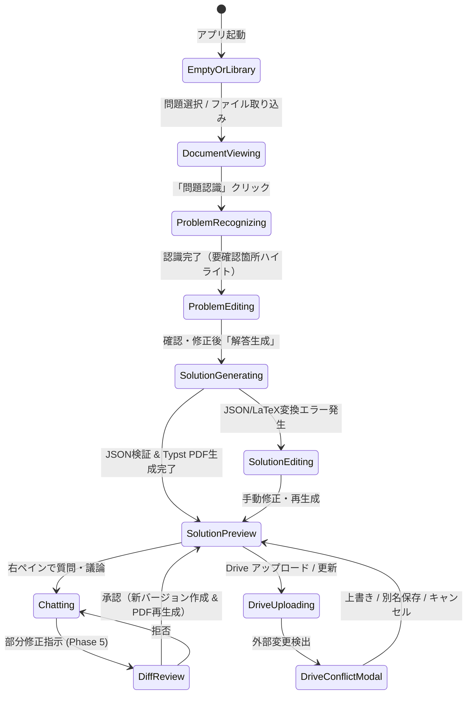

# UI / UX 設計（UI Design）

> **ステータス**: Draft v1.0
> **技術基盤**: React / TypeScript / Tailwind CSS / shadcn/ui / Lucide / Zustand / PDF.js / KaTeX
> **最終更新**: 2026-11-25

---

## 1. デザイン方針

- **学習集中型レイアウト**: Obsidian・T3 Code・VS Code を参考に、装飾を排した実用的かつ情報密度の高い 3 カラム構成を採用する。
- **可読性最優先**: 大学数学・大学物理の複雑な数式（KaTeX）と PDF・グラフの視認性を最優先にタイポグラフィと余白を設計する。
- **ライト / ダークモード**: システム連動および手動切替の両方に対応。
- **柔軟な画面領域**: 左右サイドバーはドラッグでリサイズ可能かつボタン/ショートカットで開閉可能。
- **キーボードショートカット**: 問題切替、タブ移動、検索、チャット送信、処理中断、PDF 出力などをキーボードで操作可能にする。
- **国際化（i18n）前提**: 初期言語は日本語とし、UI 文字列をコンポーネントへ直書きせず翻訳辞書（`src/lib/i18n/`）で一元管理し、Phase 6 での英語対応を容易にする。

---

## 2. メイン画面構成（3 カラムレイアウト）

```text
┌─────────────────────────────────────────────────────────────────────────┐
│ FormulaDesk   [検索 Ctrl+K]   [Drive状態]   [テーマ切替]   [⚙ 設定]     │
├────────────────┬─────────────────────────────────┬──────────────────────┤
│ ライブラリ     │ 中央パネル（ドキュメント作業域） │ AI チャット          │
│                │ [元の問題][認識文][解答PDF]      │                      │
│ [＋ 問題追加]  │ [エディタ][計算結果][履歴]       │ [エージェント][モデル]│
│                ├─────────────────────────────────┤                      │
│ 🔎 フィルタ    │                                 │ 会話履歴             │
│ ★ お気に入り   │                                 │  - Markdown + KaTeX  │
│ 🕒 最近開いた  │   PDF.js ビューア /             │  - コードブロック    │
│                │   問題編集 / 解答PDF表示        │  - ツール実行状況    │
│ 大学数学       │                                 │  - 権限確認カード    │
│  ├ 微積分      │                                 │  - 差分承認カード    │
│  ├ 線形代数    │                                 │                      │
│  └ 集合論      │                                 │ 参照中: 第2問 (1)    │
│ 大学物理       │                                 ├──────────────────────┤
│  ├ 古典力学    │                                 │ [📎画像][新規][中断] │
│  └ 電磁気学    ├─────────────────────────────────┤ 質問入力欄           │
│ 🏷 タグ        │ [問題認識][解答生成][PDF保存][☁] │ [送信 Ctrl+Enter]    │
└────────────────┴─────────────────────────────────┴──────────────────────┘
```

---

## 3. 各パネルの詳細仕様

### 3.1 左サイドバー（ライブラリ）

- **問題ファイルの追加**: ダイアログ選択ボタンに加え、サイドバーおよび中央パネル全体へのドラッグ＆ドロップ・クリップボード画像貼り付け（`Ctrl+V`）に対応。
- **科目・階層フォルダツリー**: 科目の追加・編集・削除、無制限階層のフォルダ作成・名前変更・移動・削除。
- **問題ファイル一覧**: タイトル、ページ数/形式アイコン、Google Drive アップロード状態バッジ（未送信 / 同期済 / 要更新 / 競合 / エラー）、学習ステータス（Phase 5）。
- **絞り込み・ナビゲーション**: 検索バー、タグフィルタ、最近開いた問題、お気に入り。
- **設定画面への遷移**: 左下またはヘッダーの `⚙ 設定` から設定画面へ遷移。

### 3.2 中央パネル（作業エリア・6 タブ）

| タブ | 主な機能 | 導入 Phase |
|---|---|---|
| **1. 元の問題** | PDF.js ビューア（ページ移動、拡大/縮小、サムネイルサイドバー、テキスト選択、ページ番号指定、外部保存）または画像ビューア。ページ範囲指定・領域切り出しツール。 | Phase 1 |
| **2. 認識した問題文** | 抽出済み問題一覧（問題番号・小問・分野・問題文・KaTeX プレビュー・要確認警告ハイライト）。インライン編集、問題の分割・結合、図参照の修正。 | Phase 2 |
| **3. 解答 PDF** | Typst 生成済み最新解答 PDF の PDF.js プレビュー、外部ファイル書き出し、Google Drive アップロード/更新ボタン。問題 PDF との素早い切替（Phase 5 で左右並置表示対応）。 | Phase 2 / 5 |
| **4. 解答エディタ** | 構造化解答データのフォーム/テキスト編集、LaTeX 数式リアルタイムプレビュー（KaTeX）、LaTeX→Typst 変換エラー箇所のハイライトと修正後の再コンパイル。 | Phase 2 |
| **5. 計算結果** | Science MCP ツール実行履歴（入力・出力・実行時間）、検証結果一覧（`passed`/`failed`/`inconclusive`/`not_run`/`error`、対象・仮定・手法）、生成グラフ一覧。AI 自己チェックと実ツール検証を明確に色分け・ラベル区別。 | Phase 3 |
| **6. 解答バージョン履歴** | v1, v2, v3... の履歴リスト、作成日時・モード・使用モデル・変更概要、任意バージョンの閲覧・復元・Drive アップロード、バージョン間差分表示（Phase 5）。 | Phase 2 / 5 |

### 3.3 右サイドバー（AI チャット）

- **ヘッダー**: エージェント選択ドロップダウン（ステータス表示付き）、モデル選択（対応プロバイダーのみ；未取得時は明示表示）、新規チャットボタン。
- **コンテキスト表示バー**: 現在参照中のドキュメント・問題番号・解答バージョン・添付対象をバッジ表示し、不要なコンテキスト送信をユーザーがオン/オフできる。
- **メッセージ一覧**:
  - `react-markdown` + `KaTeX` による数式描画、シンタックスハイライト付きコードブロック
  - トークン単位ストリーミング表示（中断されたメッセージは「中断済み」バッジを表示）
  - 計算ツール実行状況の折りたたみ表示（実行中スピナー / 結果サマリー）
  - **権限要求カード**: ハーネスから `PermissionRequested` が届いた際、操作内容・対象を明示して「許可 / 拒否」を提示
  - **解答修正差分カード（Phase 5）**: 既存解答との構造化差分を表示し「承認して新バージョン作成 / 拒否」を選択
  - メッセージごとのアクション: コピー、再生成
- **入力エリア**: マルチライン入力、画像添付ボタン・クリップボード貼り付け、送信ボタン、実行中は**中断（キャンセル）ボタン**へ切替。

---

## 4. 設定画面（11 カテゴリ）

設定画面はモーダルまたは専用フルビューとして開き、左メニューに以下の 11 カテゴリを配置する。

| # | カテゴリ | 主な設定項目 |
|---|---|---|
| 1 | **一般** | 表示言語（日本語 / Phase 6 で英語）、起動時動作、既定の科目・認識モード |
| 2 | **外観** | テーマ（ライト / ダーク / システム）、数式フォントサイズ、サイドバー初期幅 |
| 3 | **AI エージェント** | 自動検出結果（バージョン・公式認証状態・Capability）、手動パス指定、公式認証ガイド、カスタム ACP 追加、用途別エージェント割り当て（認識・生成・チャット・検証・修正） |
| 4 | **モデル設定** | プロバイダー別デフォルトモデル（取得可能時）、明示的同意に基づく API キー代替設定（キーチェーン保存・自動切替禁止オプション） |
| 5 | **AI プロンプト** | 大学数学・大学物理・モード別カスタム指示（システム安全制約は上書き不可） |
| 6 | **PDF 出力** | デフォルトテンプレート、用紙サイズ（A4 等）、フォント選択、メタデータ（モデル名・生成日時・バージョン）の表示/非表示 |
| 7 | **Google Drive** | OAuth 接続/切断、アカウント表示、保存先ルートフォルダ設定、アップロードモード（手動/自動/フォルダ単位）、Drive バージョン管理ポリシー、ジョブキュー状態・競合一覧 |
| 8 | **計算ツール** | Science MCP 有効/無効、Python (`uv`) パス、実行タイムアウト秒数、グラフ出力形式（SVG 優先 / PNG） |
| 9 | **ストレージ** | データ保存先ディレクトリ表示（エクスプローラーで開く）、使用容量内訳、一時ファイル/ワークスペース掃除、ローカルバックアップ作成・復元 |
| 10 | **セキュリティ** | クラウド AI 送信同意状態、任意シェル禁止ポリシー確認、ログ秘匿設定、診断ログエクスポート |
| 11 | **アプリ情報** | バージョン、ライセンス（MIT）、オープンソースコンポーネント・フォントライセンス一覧 |

---

## 5. 主要インタラクション・画面遷移フロー



---

## 6. 状態管理（Zustand）と UX 品質

### 6.1 Zustand ストア分割

不要なグローバル巨大ストアを避け、責務単位で分割する。

- `useLayoutStore`: サイドバー幅・開閉、アクティブタブ、テーマ、ショートカット状態
- `useLibraryStore`: 科目・フォルダ・ドキュメント一覧、選択中ドキュメント、フィルタ・検索条件
- `useDocumentStore`: 現在の PDF ページ・ズーム、認識済み問題一覧、選択中問題・解答バージョン
- `useChatStore`: アクティブスレッド、メッセージ一覧、ストリーミング中バッファ、実行中 `run_id`、権限要求キュー
- `useAgentStore`: 検出済みハーネス一覧、Capability、用途別割り当て
- `useDriveStore`: Drive 接続状態、ドキュメント別同期状態、ジョブキュー通知

### 6.2 状態フィードバック原則

- **オフライン明示**: ネットワーク切断時でもローカル閲覧可能であることを維持し、AI/Drive ボタンのみ分かりやすく理由を表示。
- **未取得情報の誠実表示**: 認証状態・モデル一覧・トークン利用量がハーネスから取得できない場合は「未取得」と明示しダミー値を見せない。
- **エラー表示**: 技術スタックトレースをそのまま出さず、Rust 側から返る日本語メッセージと回復アクション（「設定を開く」「再試行」「別のエージェントを選ぶ」）を提示する。

---

## 関連ドキュメント

- [製品仕様書（product-specification.md）](./product-specification.md)
- [システムアーキテクチャ（architecture.md）](./architecture.md)
- [テスト方針（testing.md）](./testing.md)
